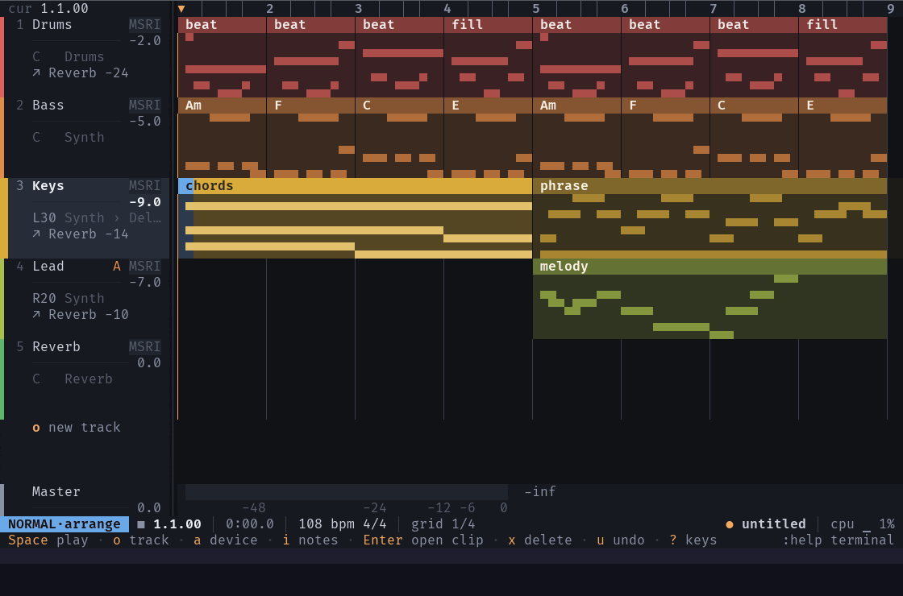
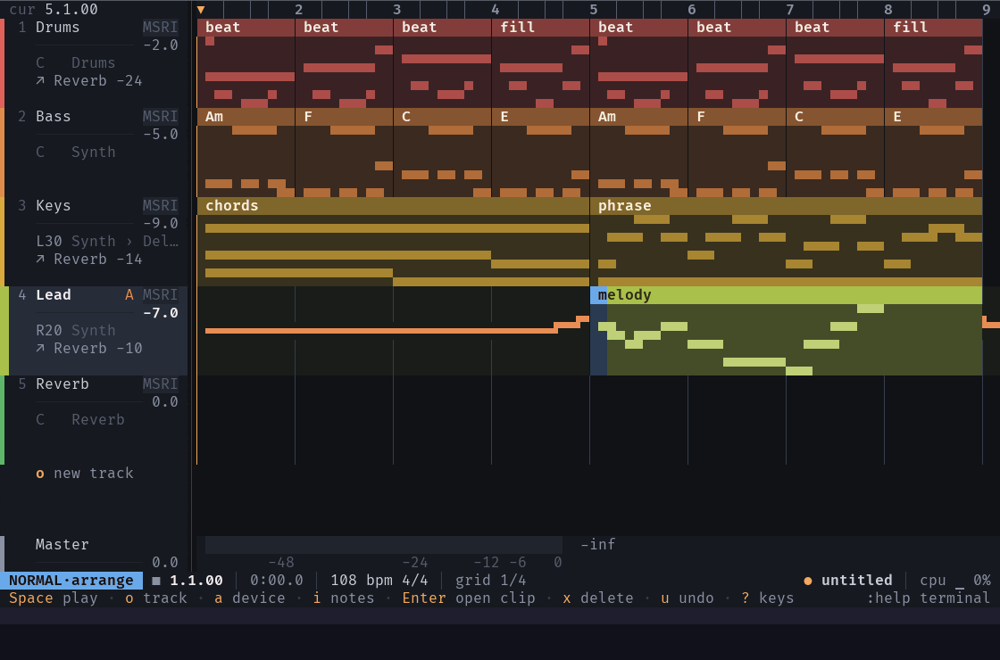
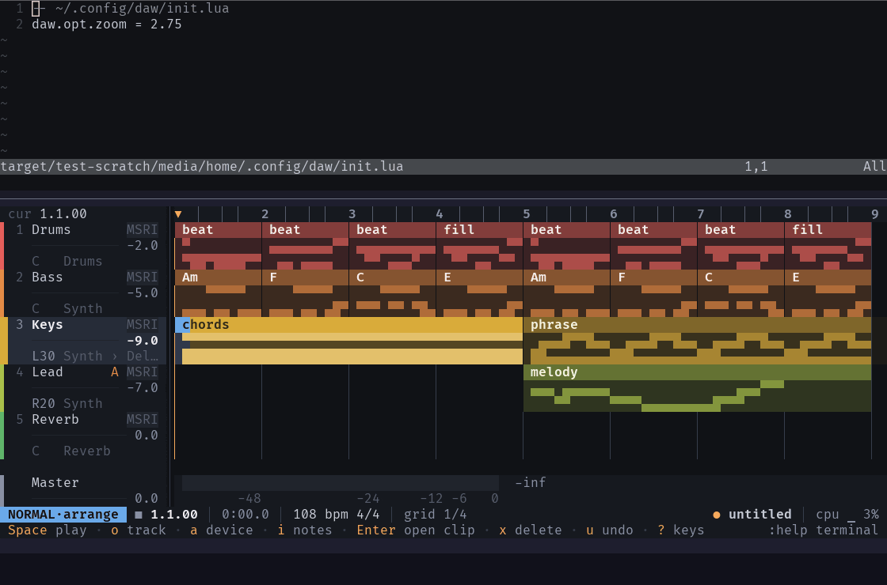
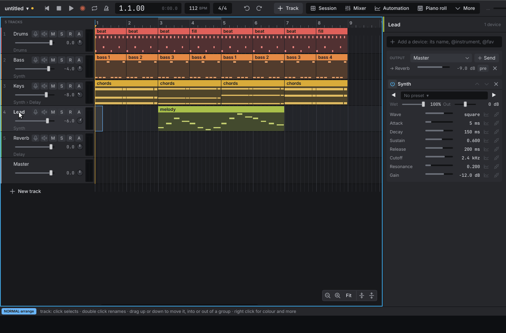

# paw

**A personal audio workstation you drive like Neovim and rebuild in Lua.**

[](#license)


Make paw fit your music, not the other way around. A small Rust kernel plays
the sound, keeps the project and hosts plugins; everything you touch, every
view, command and key, is Lua that your own configuration can change. Extend
it with [your `init.lua`](docs/configuration.md), [extensions](#extensions),
[devices written in Lua](docs/devices.md#writing-a-device-in-lua) and
[kinds of track](docs/extensions.md#everything-an-extension-can-own), and
package them for Nix or share them as a git repository.

paw ships a complete DAW core but leaves the score, drum grids and singing
to extensions. Write the feature you want in a few lines of Lua, or load an
extension that does it your way.

```lua
-- ~/.config/paw/init.lua: :reload applies it without stopping the sound
paw.ui.hl("Playhead", { bg = "#f38ba8" })
paw.keymap.set("<leader>T", "track.add Strings device=synth", { desc = "A strings track" })
```

Drive it from the keyboard in the [terminal](docs/terminal.md), with the
mouse in a [window](docs/window.md), from [Lua scripts](docs/scripting.md),
over a [socket](docs/protocol.md), or from an AI assistant through `paw-mcp`.
They all drive one kernel and can be open on the same project.

> [!NOTE]
> paw is a **personal, work-in-progress** project, made first for one
> person's music and taste. It runs on Linux (PipeWire, ALSA or JACK). It
> plays, edits, records and renders MIDI and audio through built-in devices
> and CLAP, LV2 and VST3 plugins, but much of it has been tested against
> stand-ins rather than real hardware, and things change without notice. See
> [what is missing](docs/missing.md).

[Try it](#try-it) · [Is paw for you?](#is-paw-for-you) ·
[What it does](#what-it-does) · [A tour](#a-tour) ·
[Extensions](#extensions) · [Documentation](#documentation)

## Try it

You need Linux and [Nix](https://nixos.org/download/) with flakes enabled
(`experimental-features = nix-command flakes` in `nix.conf`). The first run
builds paw from source, which takes several minutes.

```sh
git clone https://github.com/AlejandroGomezFrieiro/custom_daw paw && cd paw
nix run . -- -e 'dofile("examples/demo-song.lua")'          # the terminal, with a demo song
nix run .#paw-gui -- -e 'dofile("examples/demo-song.lua")'  # the window, with the same song
```

`Space` plays, `?` lists every key of the view you are in, `:tutor` runs a
course of seventeen short lessons, `:help` opens the manual and `:q` quits.
`nix run . -- doctor` checks your sound devices, MIDI ports and plugins.
[Running it](docs/running.md) covers installing, building from source and
the audio options.

## Is paw for you?

paw is for people who like open programs they can take apart: who live in
Neovim or a tiling window manager, keep their configuration in a repository,
and would rather write ten lines of Lua than wait for a feature.

| If you want | Look at |
| --- | --- |
| A keyboard-first, modal DAW you script and reshape, terminal or window | **paw** |
| A mature, deeply customisable DAW on every platform | [REAPER](https://www.reaper.fm) |
| A mature open-source DAW for recording and mixing on Linux | [Ardour](https://ardour.org) |
| Sound design, modulation and performance | [Bitwig Studio](https://www.bitwig.com), [Ableton Live](https://www.ableton.com) |
| Keyboard-driven composing in a tracker | [Renoise](https://www.renoise.com) |
| Engraving first, playback second | [MuseScore](https://musescore.org), [Dorico](https://www.steinberg.net/dorico/) |

paw is younger and smaller than all of them; choose it for the way it works,
not for the size of its feature list.

## What it does

- **Editing.** MIDI and audio clips, a piano roll, take lanes with comping,
  time stretch and pitch shift, looping clips, markers, a tempo map with
  signature changes, and an undo tree that never loses a branch.
- **Recording.** Audio and MIDI with an input and monitoring per track, loop
  recording into takes, punch in and out, count-in. Takes survive a crash.
- **Mixing.** Groups, sends, side-chains, instruments with several outputs,
  automation with read, touch, latch and write modes, controller learn.
- **Devices.** A synth, a drum kit, a sampler and fifteen effects and meters,
  devices written in Lua, and your CLAP, LV2 and VST3 plugins, each in a
  process of its own so that a crash takes nothing else with it.
- **Files.** Projects are readable JSON. Renders to WAV and FLAC (MP3, Ogg
  and Opus through ffmpeg) on a background thread; MIDI files open and export.
- **Live and remote.** Clips launched on the bar in scenes
  ([live](docs/live.md)); the terminal or the window attached to an instance
  on another machine over TLS ([running](docs/running.md#on-another-machine)).

## A tour

Keys work as in Vim, on a timeline instead of a text: counts, operators,
motions, text objects, visual mode, registers, macros, marks and `.`. One
rule holds in every view: `h` `j` `k` `l` only move, `+` `-` change the value
under the cursor, `Esc` cancels.


The command line takes Ex commands where a line is a bar and a range can be
tracks (`:5,8d`, `:t2,t4 mute`, `:%s/c4/d4/gc`), previewed as you type:


The mixer, the device picker and the device panel are views like any other,
and pickers play what they would choose before you choose it:



Tracks, sends, devices and markers can be edited as text, as directories are
in oil.nvim; `:w` shows the plan and applies it as one undo step:


<details>
<summary>More: recording, help, configuration, the window</summary>






The window shows the same views as panes for the mouse; keys still work in
it. [docs/window.md](docs/window.md) has every gesture.




</details>

The whole keyboard is on one page in [docs/course/keys.md](docs/course/keys.md).

## Extensions

An extension is a directory of Lua that adds commands, keys, views, windows,
devices and kinds of track. It can also ship the native programs it needs,
built by Nix: [utau](extensions/utau) brings its own singing engine, and the
core knows nothing about singing. See
[everything an extension can own](docs/extensions.md#everything-an-extension-can-own).

| Extension | Adds |
| --- | --- |
| [notation](extensions/notation) | a clip as a score or tablature, engraved, a view over its MIDI |
| [utau](extensions/utau) | vocal tracks sung by OpenUtau's voicebanks, with their own editor |
| [drums](extensions/drums) | drum tracks and a grid to program them on |
| [pattern](extensions/pattern) | clips written as a line of text, as in TidalCycles |
| [musicops](extensions/musicops) | humanize, strum, arpeggiate and other note edits |
| [sections](extensions/sections) | intro, verse and chorus as named stretches of the song |
| [templates](extensions/templates) | tracks and device chains saved under a name |
| [undotree](extensions/undotree) | the undo tree, to walk through |
| [projdiff](extensions/projdiff) | what changed in a project, and merging two versions of it, in git too |
| [mixdiag](extensions/mixdiag) | measurements of the mix, and what is wrong with it |
| [rpp](extensions/rpp) | opening and writing REAPER projects |
| [vinput](extensions/vinput) | virtual inputs, such as a guitar turned into MIDI |
| [tutor](extensions/tutor) | the course, inside the program |
| [doctor](extensions/doctor) | checks of your sound card, MIDI devices and plugins |

Each one's page shows it at work. Load them from `init.lua`
([config/init.lua](config/init.lua) loads them all), or build paw with them
in Nix: `paw.withExtensions (exts: [ exts.utau ])`.

## Documentation

| Page | About |
| --- | --- |
| [Running it](docs/running.md) | installing, options, audio devices, other machines |
| [The terminal](docs/terminal.md) | every key and picker, Ex, text buffers, quickfix, `:help` |
| [The window](docs/window.md) | every gesture |
| [Recording](docs/recording.md) and [mixing](docs/mixing.md) | inputs, takes, routing, automation, tempo, export |
| [Devices](docs/devices.md) | plugins, the sandbox, built-in devices, devices in Lua |
| [Configuration](docs/configuration.md) and [scripting](docs/scripting.md) | options, the look, the `paw` module, `paw ctl` |
| [Extensions](docs/extensions.md) | what belongs in the core, and what an extension can own |
| [Architecture](docs/architecture.md) and [protocol](docs/protocol.md) | the crates, the threads, the socket |
| [What is missing](docs/missing.md) | what it does not do yet |

## Inspiration

- [Neovim](https://neovim.io) and Vim: the modal grammar, Ex, the quickfix
  list, `:help`, a small core with everything else in Lua, and
  [oil.nvim](https://github.com/stevearc/oil.nvim) for lists edited as text.
- [pi](https://pi.dev), the minimal coding agent: a small core that trusts
  you, with everything else added as extensions you own.
- [REAPER](https://www.reaper.fm): a light, scriptable DAW, and notation as a
  view over MIDI.
- [Ardour](https://ardour.org), [Bitwig Studio](https://www.bitwig.com) and
  [Renoise](https://www.renoise.com) for the DAW, [Dorico](https://www.steinberg.net/dorico/)
  and [MuseScore](https://musescore.org) for the score, and
  [TidalCycles](https://tidalcycles.org) for patterns as text.

## Contributing

paw is a personal project that follows one person's taste, so it moves at its
own pace. Bug reports, questions and ideas are welcome as GitHub issues; for
anything larger than a small fix, open an issue before a pull request. The
tests (`cargo test --release`, `tests/tools/suite.sh`) must pass, and new
behaviour comes with a test. They use a null audio backend and a private X
display, so they touch neither your sound card nor your screen. The pictures
here are recordings of the real program, made again by
[docs/images/make](docs/images/make).

## License

paw is licensed under either of [MIT](LICENSE-MIT) or
[Apache-2.0](LICENSE-APACHE), at your option. Unless you state otherwise,
any contribution you submit for inclusion is licensed the same way, without
additional terms or conditions.
