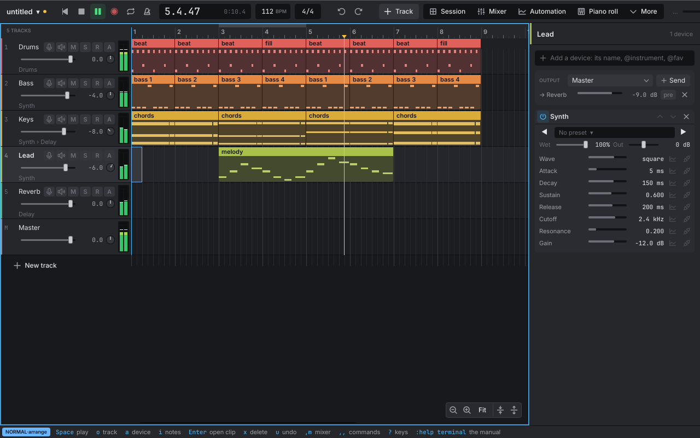
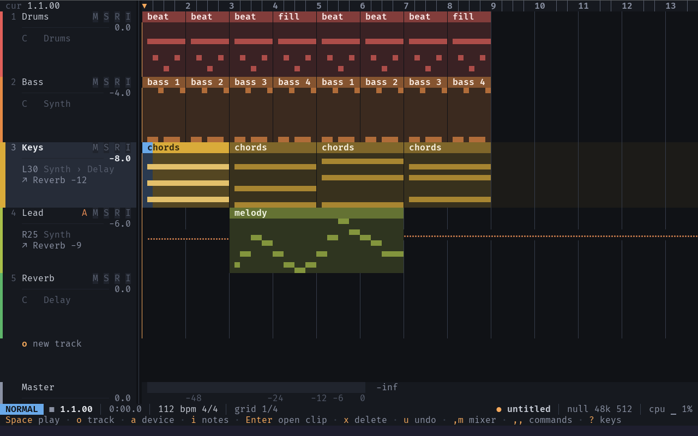
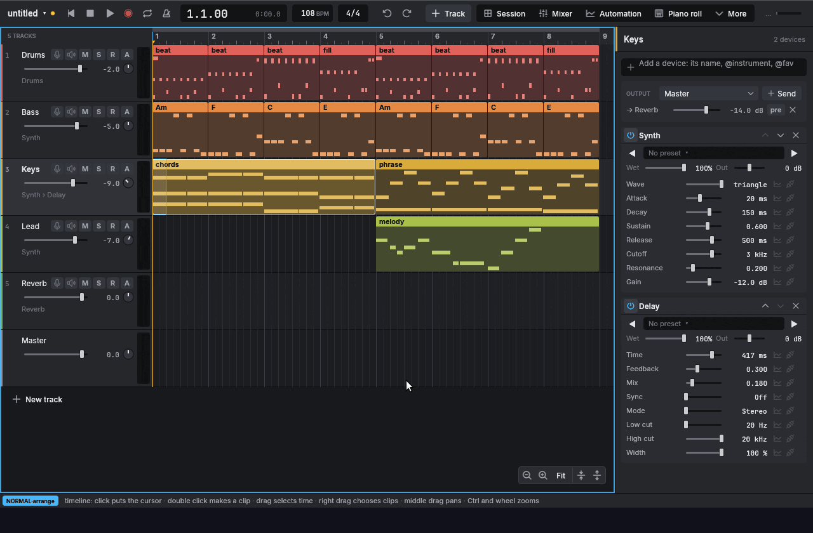
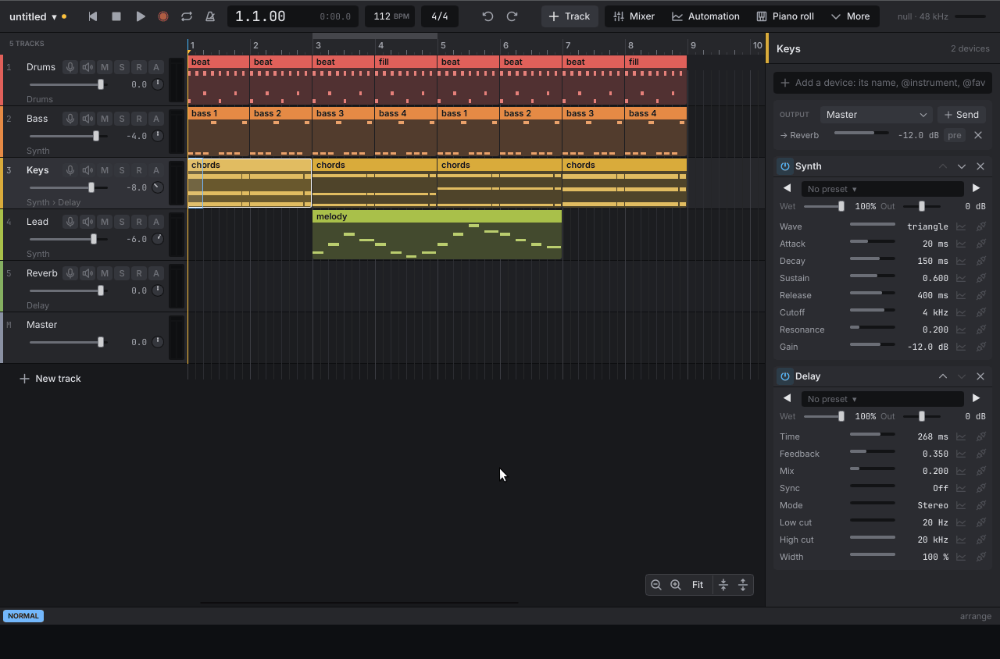

# paw

A Personalized (digital) Audio Workstation built the way Neovim is built: a small kernel, and
everything you touch written in Lua on top of it. You can drive it from the
keyboard with modal editing, from a window with the mouse, or from a script.





The kernel is Rust: a real-time audio engine, the project model with its undo
tree, plugin hosting and a Lua host. The arrange view, the mixer, the piano
roll, every command and every key are Lua, written with the same `daw` module
your own configuration and extensions use. The terminal UI and the window are
two faces of one kernel, and both can be open on the same project.

> [!NOTE]
> This is an early, personal project. It runs on Linux (PipeWire, ALSA or
> JACK) and is built with Nix. It plays, edits, records and renders MIDI and
> audio through built-in devices and CLAP, LV2 and VST3 plugins, but most of
> it has been tested against stand-ins, not real hardware. See
> [what is missing](docs/missing.md).

## Try it

```sh
nix develop                      # the Rust toolchain and the system libraries
cargo build --release

target/release/daw -e 'dofile("examples/demo-song.lua")'       # the terminal UI, with a demo song
target/release/daw-gui -e 'dofile("examples/demo-song.lua")'   # the window, with the same song
target/release/daw doctor        # check your sound devices, MIDI ports and plugins
```

Or without the dev shell: `nix run .` (the terminal UI) and `nix run .#daw-gui`
(the window); `nix profile install .` installs them
([Installing with Nix](docs/running.md#installing-with-nix)).

In the terminal, `?` lists every key of the view you are in, `:` runs any
command by name, and `:q` quits. A course of sixteen ten-minute lessons runs
inside the program (`:tutor`, once the `tutor` extension is loaded) and can
also be read in [docs/course](docs/course/README.md).

## In the terminal

Keys work as they do in Vim, on a timeline instead of a text. In the arrange
view a track is a line and a clip is a word; in the piano roll a pitch is a
line and a note is a word. Counts, operators, motions, text objects, visual
mode, registers, macros, marks and `.` all apply: `3>ic` moves a clip three
steps later, `yic` yanks it, `dd` deletes a track.


Notes are typed. `i` opens a clip and the home row becomes a piano:


The mixer, the device picker and the device panel are views like any other:


| To | Press |
| --- | --- |
| Move by track, by clip, by bar | `j` `k`, `w` `b`, `W` `B` |
| Play and stop | `Space` |
| Add a track, add a device | `o`, `a` |
| Open a clip's notes, type notes | `Enter`, `i` |
| Delete, yank, paste | `x` or `d`…, `y`…, `p` |
| Undo, redo | `u`, `Ctrl-r` |
| Mixer, device panel, piano roll | `,m` `,d` `,p` |
| Find a command, a key, any picker | `,,` `,fk` `,fp` |
| Arm a track, record | `r`, `R` |

[docs/course/keys.md](docs/course/keys.md) is the whole keyboard on one page,
and [docs/terminal.md](docs/terminal.md) explains it.

## In the window

The window is for the mouse. Clips are dragged, trimmed, copied and
stretched; everything else is on the right button.



The piano roll is a pencil: drag to draw, drag a note to move it, right-drag
to select with a box, and draw velocities and controllers in the strip below.



Devices are added by name, the mixer has a strip for every track, and a
parameter is automated by drawing its curve:


Keys still work in the window: it passes them to the same mappings the
terminal uses. [docs/window.md](docs/window.md) has every gesture.

## What it does

- **Editing.** MIDI and audio clips, a piano roll, take lanes with comping,
  time stretch and pitch shift, looping clips, markers and regions, a tempo
  map with signature changes, and an undo tree that never loses a branch.
  Drum grids and staff notation come as extensions.
- **Recording.** Audio and MIDI with an input and monitoring for each track,
  loop recording into takes, punch in and out, count-in. Takes survive a
  crash.
- **Mixing.** Groups, sends, side-chains, instruments with several outputs,
  automation with read, touch, latch and write modes, and controller learn.
- **Devices.** A synth, a drum kit, a sampler and fifteen effects and meters
  (equaliser, compressor, reverb, limiter and so on), plus your CLAP, LV2 and
  VST3 plugins. Each plugin runs in a process of its own, so one that crashes
  takes nothing else with it. Tracks can also send their MIDI to hardware.
- **Files.** Projects are JSON you can read. Renders to WAV, FLAC, MP3, Ogg
  and Opus, whole or by region, on a background thread. REAPER projects open
  through the `rpp` extension.
- **Playing live.** Clips in slots beside the timeline, launched on the bar
  from the keyboard, the mouse or a pad, in scenes. See [Live performance](docs/live.md).
- **Somewhere else.** `daw attach` shows the terminal UI of a running
  instance in another terminal, and `daw-gui --connect` puts the window on an
  instance on another machine, over TLS, each with a cursor and mode of its
  own; files and sound go across too. See
  [docs/running.md](docs/running.md#on-another-machine).

## Make it yours

`~/.config/daw/init.lua` runs at startup, and `:reload` runs it again without
stopping the sound. Nothing in it is special: these are the calls the
built-in keys and commands are made with.

```lua
daw.opt.grid = 0.5
daw.ui.hl("Playhead", { bg = "#ff5555" })

daw.command("track.synth", function(ctx)
  local track = daw.add_track({ name = ctx.args[1] or "Synth" })
  track:add_device("synth", { cutoff = tonumber(ctx.args.cutoff) or 1800 })
  daw.cursor.set_track(track)
end, { desc = "Add a synth track: `track.synth Lead cutoff=900`" })

daw.keymap.set("<leader>s", "track.synth", { desc = "Add a synth track" })
daw.on("project.saved", function(event) daw.notify("saved to " .. event.path) end)
```

[config/init.lua](config/init.lua) is a fuller starting point that loads the
bundled extensions; link the `config` directory to `~/.config/daw` to use it.

Extensions are directories of Lua that add commands, keys, views, windows
and kinds of track. The ones in this repository:

| Extension | Adds |
| --- | --- |
| [tutor](extensions/tutor) | the course, inside the program |
| [drums](extensions/drums) | drum tracks and a grid to program them on |
| [notation](extensions/notation) | a clip as staff notation or tablature, to read and to edit |
| [pattern](extensions/pattern) | clips written as a line of text, in the manner of TidalCycles |
| [musicops](extensions/musicops) | humanize, strum, arpeggiate and other everyday note edits |
| [sections](extensions/sections) | intro, verse and chorus as named stretches of the song |
| [templates](extensions/templates) | tracks, groups and device chains saved under a name |
| [undotree](extensions/undotree) | the undo tree, to walk through |
| [mixdiag](extensions/mixdiag) | measurements of the mix, and what is wrong with it |
| [utau](extensions/utau) | vocal tracks sung by OpenUtau's engines |
| [vinput](extensions/vinput) | virtual inputs, such as a guitar turned into MIDI |
| [rpp](extensions/rpp) | opening and writing REAPER projects |
| [doctor](extensions/doctor) | checks of your sound card, MIDI devices and plugins |

## Scripts and other programs

The same module works without a UI, and a running instance answers on a
socket:

```sh
daw -l examples/demo.lua demo.wav          # build a song in Lua and render it
daw ctl eval 'daw.transport.position'
daw ctl cmd track.add Bass device=synth
daw ctl track_set 3 volume -6
```

`daw-mcp` offers the same calls to AI assistants over the Model Context
Protocol.

## Documentation

| Page | About |
| --- | --- |
| [Running it](docs/running.md) | options, audio devices, recent projects, the tests |
| [The terminal interface](docs/terminal.md) | every key and picker |
| [The graphical frontend](docs/window.md) | every gesture in the window |
| [Input and recording](docs/recording.md) | inputs, monitoring, takes, punch, count-in |
| [Editing, mixing and rendering](docs/mixing.md) | routing, automation, tempo, stretching, markers, export |
| [Live performance](docs/live.md) | clips in slots, launched on the bar, scenes, capturing a performance |
| [Plugins and built-in devices](docs/devices.md) | CLAP, LV2, VST3, the sandbox, the built-in devices |
| [Configuration](docs/configuration.md) | options, colours, the look |
| [Scripting](docs/scripting.md) | the `daw` module, scripts, `daw ctl` |
| [Extensions](docs/extensions.md) | what belongs in the core and what in an extension |
| [The control protocol](docs/protocol.md) | the socket, the network, remote terminals and windows |
| [How it is put together](docs/architecture.md) | the crates, the threads, the rules of the design |
| [What is missing](docs/missing.md) | what it does not do yet |

## Working on it

```sh
cargo test --release               # Rust tests, and the real window driven on a private display
tests/tools/suite.sh               # the end-to-end suite, in Lua
tests/tools/suite.sh plugins       # the same with real CLAP, LV2 and VST3 plugins
docs/images/make/make.sh           # make the pictures on this page again
```

The tests use a null audio backend and a private X display: they do not
touch your sound card or your screen. The pictures on this page are
recordings of the real program, driven by the scripts in
[docs/images/make](docs/images/make).

The crates are declared as MIT OR Apache-2.0 in `Cargo.toml`.
