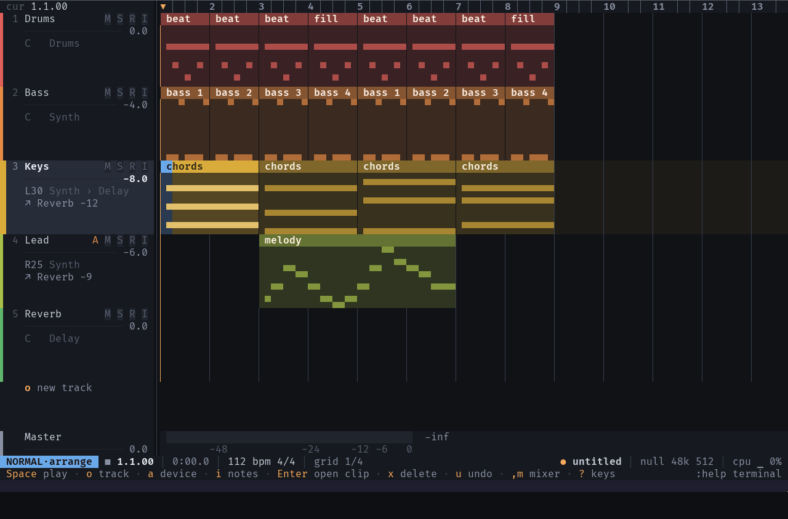
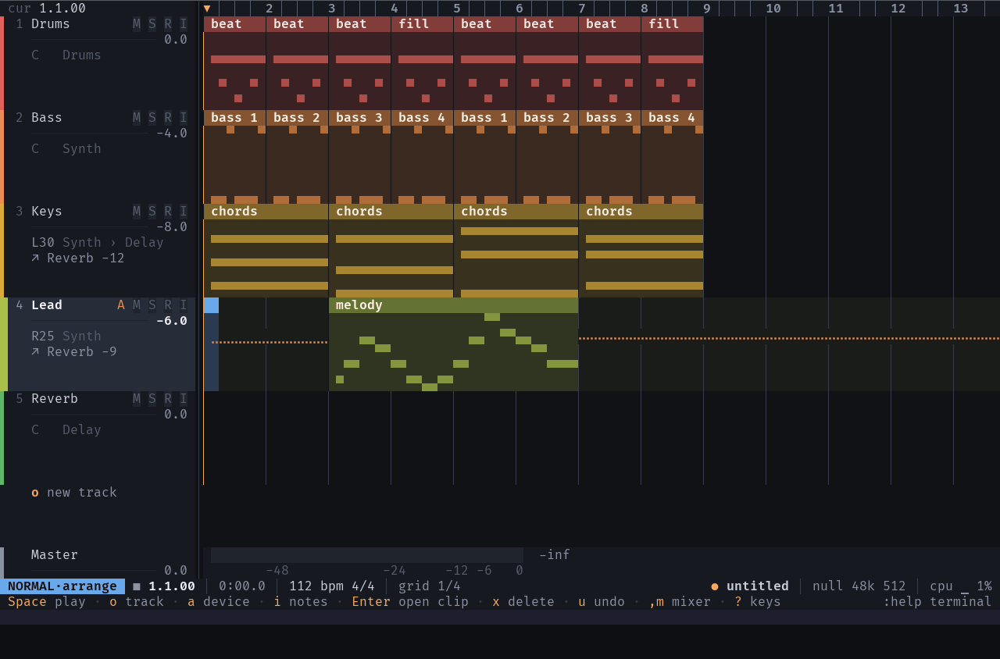
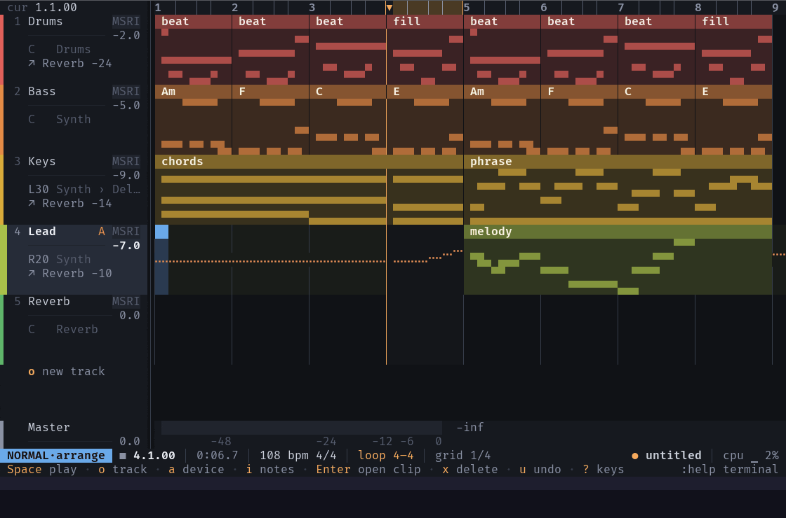
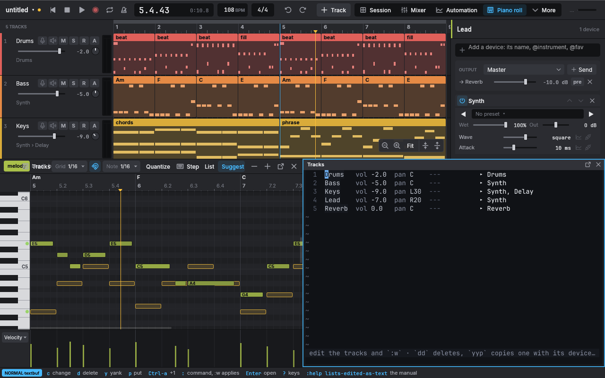

# paw

**A personal audio workstation you drive like Neovim and rebuild in Lua.**

[](#license)




- **Modal, on a timeline.** A track is a line and a clip is a word: `3>ic`
  moves a clip three steps later, `:%s/c4/d4/gc` changes notes with a preview,
  `:e daw://tracks` edits your tracks as text.
- **Lua all the way up.** A small Rust kernel (audio engine, project model,
  plugin hosting); the views, every command and every key are Lua your
  `init.lua` can change, replace or extend.
- **One program, three faces.** The terminal, a window for the mouse, and
  scripts all drive the same kernel, and can be open on the same project.


> [!NOTE]
> paw is a **personal, work-in-progress** project, made first for one
> person's music and taste. It runs on Linux (PipeWire, ALSA or JACK) and is
> built with Nix. It plays, edits, records and renders MIDI and audio through
> built-in devices and CLAP, LV2 and VST3 plugins, but most of it has been
> tested against stand-ins, not real hardware, and things change without
> notice. See [what is missing](docs/missing.md).

## Try it

You need Linux and [Nix](https://nixos.org/download/) with flakes enabled
(`experimental-features = nix-command flakes` in `nix.conf`).

```sh
git clone https://github.com/AlejandroGomezFrieiro/custom_daw paw && cd paw
nix run . -- -e 'dofile("examples/demo-song.lua")'          # the terminal UI, with a demo song
nix run .#daw-gui -- -e 'dofile("examples/demo-song.lua")'  # the window, with the same song
```

Then press `Space` to play, `?` to list every key of the view you are in,
`:tutor` for a course of seventeen short lessons (also in
[docs/course](docs/course/README.md)), `:help` for the manual, and `:q` to
quit. `nix run . -- doctor` checks your sound devices, MIDI ports and plugins.

To build it yourself, or install it:

```sh
nix develop                      # the Rust toolchain and the system libraries
cargo build --release            # target/release/daw and target/release/daw-gui
nix profile install .            # or install both programs
```

The programs keep short names for now: `daw` is paw's terminal interface,
`daw-gui` its window, and the Lua module is `daw`. See
[Installing with Nix](docs/running.md#installing-with-nix).

## Is paw for you?

paw is for people who like open programs they can take apart: who live in
Neovim or a tiling window manager, keep their configuration in a repository,
and would rather write ten lines of Lua than wait for a feature.

| If you want | Look at |
| --- | --- |
| A keyboard-first, modal DAW you script and reshape, terminal or window | **paw** |
| A mature, deeply customisable DAW on every platform | [REAPER](https://www.reaper.fm) |
| A mature open-source DAW for recording and mixing on Linux | [Ardour](https://ardour.org) |
| Sound design, modulation and performance | [Bitwig Studio](https://www.bitwig.com), [Ableton Live](https://www.ableton.com) |
| Keyboard-driven composing in a tracker | [Renoise](https://www.renoise.com) |
| Engraving first, playback second | [MuseScore](https://musescore.org), [Dorico](https://www.steinberg.net/dorico/) |

paw is younger and smaller than all of them; choose it for the way it works,
not for the size of its feature list.

## In the terminal

Keys work as they do in Vim, on a timeline instead of a text. Counts,
operators, motions, text objects, visual mode, registers, macros, marks and
`.` all apply, and one rule holds in every view: `h` `j` `k` `l` only move,
`+` `-` change the value under the cursor, `Esc` cancels and never leaves.


Notes are drawn or typed. `Enter` opens a clip; `i` draws a note with the
cursor, and `I` turns the home row into a piano:



The mixer, the device picker and the device panel are views like any other:


Recording goes round the loop into takes, shown as lanes and comped by
choosing a take over a selection:



### Score, engraved in the terminal

A clip can be read and written as staff notation, drawn with a music font as
pictures in terminals that show images (WezTerm, kitty, Ghostty), and in cells
elsewhere. Notes are entered as in a notation program; dynamics, tempo, key
and the rest are written with a prompt on the local leader (`\`), as in Dorico, and you
hear each one before you write it. The notation has a grammar of its own:
`gUib` raises a bar a step in the key, `g(ip` slurs a phrase.

The score is a view of the clip's MIDI, as REAPER's notation is: writing
in it edits the notes, and the piano roll beside it edits the same notes.
Without the extension the clip is plain MIDI that plays and edits as any
other. See the [notation extension](extensions/notation/README.md).

### Ex, over bars and tracks

The command line takes Vim's Ex commands where a line is a bar and a range
can be tracks: `:5,8d`, `:t2,t4 mute`, `:%s/c4/d4/gc`. What you type is
previewed live, and `c` asks about each match.


### Lists as text, the quickfix list, help

Tracks, sends, devices and markers are text buffers, as directories are in
oil.nvim: edit the lines, `:w` shows the plan, `y` applies it as one undo
step. Problems found anywhere land in one quickfix list (`:copen`, `]q`).
Pickers play what they would choose before you choose it. And the manual is
inside, as Vim's is.


| To | Press |
| --- | --- |
| Move by track, by clip, by bar | `j` `k`, `w` `b`, `W` `B` |
| Play and stop | `Space` |
| Add a track, add a device | `o`, `a` |
| Open a clip's notes, type notes | `Enter`, `i` |
| Delete, yank, paste | `x` or `d`..., `y`..., `p` |
| Undo, redo | `u`, `Ctrl-r` |
| Mixer, device panel, piano roll, score | `,m` `,d` `,p` `,n` |
| Find a command, a key, any picker | `,,` `,fk` `,fp` |
| Arm a track, record | `r`, `R` |

[docs/course/keys.md](docs/course/keys.md) is the whole keyboard on one page,
and [docs/terminal.md](docs/terminal.md) explains it.

## In the window

The window is for the mouse, and shows the terminal's windows as panes you
can drag the borders of: the arrange view with the device panel beside it,
the piano roll, the score, a list of tracks as text, the quickfix list.



Clips are dragged, trimmed, copied and stretched; everything else is on the
right button.


The piano roll is a pencil: drag to draw, drag a note to move it, right-drag
to select with a box, and draw velocities and controllers in the strip below.


The score is engraved with the same font, docked beside the piano roll; a
click enters a note, with a shadow note under the pointer to show where. The
[notation extension](extensions/notation/README.md) has its pictures.

Devices are added by name, the mixer has a strip for every track, and a
parameter is automated by drawing its curve:


Keys still work in the window: it passes them to the same mappings the
terminal uses. [docs/window.md](docs/window.md) has every gesture.

## What it does

- **Editing.** MIDI and audio clips, a piano roll, take lanes with comping,
  time stretch and pitch shift, looping clips, markers and regions, a tempo
  map with signature changes, and an undo tree that never loses a branch.
  Drum grids and staff notation come as extensions.
- **Recording.** Audio and MIDI with an input and monitoring for each track,
  loop recording into takes, punch in and out, count-in. Takes survive a
  crash.
- **Mixing.** Groups, sends, side-chains, instruments with several outputs,
  automation with read, touch, latch and write modes, and controller learn.
- **Devices.** A synth, a drum kit, a sampler and fifteen effects and meters
  (equaliser, compressor, reverb, limiter and so on), plus your CLAP, LV2 and
  VST3 plugins. Each plugin runs in a process of its own, so one that crashes
  takes nothing else with it. Tracks can also send their MIDI to hardware.
- **Files.** Projects are JSON you can read. Renders to WAV, FLAC, MP3, Ogg
  and Opus, whole or by region, on a background thread. MIDI files open and
  export; MusicXML (from MuseScore, Dorico or Sibelius) opens as scores and
  exports again, and scores print to PDF. REAPER projects open through the
  `rpp` extension.
- **Playing live.** Clips in slots beside the timeline, launched on the bar
  from the keyboard, the mouse or a pad, in scenes. See [Live performance](docs/live.md).
- **Somewhere else.** `daw attach` shows the terminal UI of a running
  instance in another terminal, and `daw-gui --connect` puts the window on an
  instance on another machine, over TLS, each with a cursor and mode of its
  own; files and sound go across too. See
  [docs/running.md](docs/running.md#on-another-machine).

## Make it yours

`~/.config/daw/init.lua` runs at startup, and `:reload` runs it again without
stopping the sound. Nothing in it is special: these are the calls the
built-in keys and commands are made with.


```lua
daw.opt.grid = 0.5
daw.ui.hl("Playhead", { bg = "#ff5555" })

daw.command("track.synth", function(ctx)
  local track = daw.add_track({ name = ctx.args[1] or "Synth" })
  track:add_device("synth", { cutoff = tonumber(ctx.args.cutoff) or 1800 })
  daw.cursor.set_track(track)
end, { desc = "Add a synth track: `track.synth Lead cutoff=900`" })

daw.keymap.set("<leader>s", "track.synth", { desc = "Add a synth track" })
daw.on("project.saved", function(event) daw.notify("saved to " .. event.path) end)
```

[config/init.lua](config/init.lua) is a fuller starting point that loads the
bundled extensions; link the `config` directory to `~/.config/daw` to use it.

Extensions are directories of Lua that add commands, keys, views, windows
and kinds of track. The ones in this repository:

| Extension | Adds |
| --- | --- |
| [tutor](extensions/tutor) | the course, inside the program |
| [drums](extensions/drums) | drum tracks and a grid to program them on |
| [notation](extensions/notation) | a clip as staff notation or tablature, to read and to edit |
| [pattern](extensions/pattern) | clips written as a line of text, in the manner of TidalCycles |
| [musicops](extensions/musicops) | humanize, strum, arpeggiate and other everyday note edits |
| [sections](extensions/sections) | intro, verse and chorus as named stretches of the song |
| [templates](extensions/templates) | tracks, groups and device chains saved under a name |
| [undotree](extensions/undotree) | the undo tree, to walk through |
| [mixdiag](extensions/mixdiag) | measurements of the mix, and what is wrong with it |
| [utau](extensions/utau) | vocal tracks sung by OpenUtau's engines |
| [vinput](extensions/vinput) | virtual inputs, such as a guitar turned into MIDI |
| [rpp](extensions/rpp) | opening and writing REAPER projects |
| [doctor](extensions/doctor) | checks of your sound card, MIDI devices and plugins |

## Scripts and other programs

The same module works without a UI, and a running instance answers on a
socket:

```sh
daw -l examples/demo.lua demo.wav          # build a song in Lua and render it
daw ctl eval 'daw.transport.position'
daw ctl cmd track.add Bass device=synth
daw ctl track_set 3 volume -6
```

`daw-mcp` offers the same calls to AI assistants over the Model Context
Protocol.

## Documentation

| Page | About |
| --- | --- |
| [Running it](docs/running.md) | options, audio devices, recent projects, the tests |
| [The terminal interface](docs/terminal.md) | every key and picker, Ex, text buffers, the quickfix list, `:help` |
| [The graphical frontend](docs/window.md) | every gesture in the window |
| [Input and recording](docs/recording.md) | inputs, monitoring, takes, punch, count-in |
| [Editing, mixing and rendering](docs/mixing.md) | routing, automation, tempo, stretching, markers, export |
| [Live performance](docs/live.md) | clips in slots, launched on the bar, scenes, capturing a performance |
| [Notation](extensions/notation/README.md) | the score: entering notes, popovers, the grammar, the engraved page |
| [Harmony, completion and snippets](docs/harmony.md) | suggestions as ghost notes in the piano roll, and how to write a source |
| [Plugins and built-in devices](docs/devices.md) | CLAP, LV2, VST3, the sandbox, the built-in devices |
| [Configuration](docs/configuration.md) | options, colours, the look |
| [Scripting](docs/scripting.md) | the `daw` module, scripts, `daw ctl` |
| [Extensions](docs/extensions.md) | what belongs in the core and what in an extension |
| [The control protocol](docs/protocol.md) | the socket, the network, remote terminals and windows |
| [How it is put together](docs/architecture.md) | the crates, the threads, the rules of the design |
| [What is missing](docs/missing.md) | what it does not do yet |

## Working on it

```sh
cargo test --release               # Rust tests, and the real window driven on a private display
tests/tools/suite.sh               # the end-to-end suite, in Lua
tests/tools/suite.sh plugins       # the same with real CLAP, LV2 and VST3 plugins
docs/images/make/make.sh           # make the pictures on this page again (`all`: the extensions' too)
```

The tests use a null audio backend and a private X display: they do not
touch your sound card or your screen. The pictures on this page are
recordings of the real program, driven by the scripts in
[docs/images/make](docs/images/make).

## Inspiration

- [Neovim](https://neovim.io) and Vim: the modal grammar, Ex, the quickfix
  list, `:help`, a small core with everything else in Lua, and
  [oil.nvim](https://github.com/stevearc/oil.nvim) for lists edited as text.
- [pi](https://pi.dev), the minimal coding agent: a tiny core that does
  little and trusts you, with everything else added as extensions you own.
- [REAPER](https://www.reaper.fm): a light, scriptable DAW, and notation as
  a view over MIDI.
- [Ardour](https://ardour.org), [Bitwig Studio](https://www.bitwig.com) and
  [Renoise](https://www.renoise.com) for the DAW itself, and
  [Dorico](https://www.steinberg.net/dorico/) and
  [MuseScore](https://musescore.org) for the score (Dorico's popovers).
- [TidalCycles](https://tidalcycles.org) for patterns written as text.

## Contributing

paw is a personal project that follows one person's taste, so it moves at
its own pace. Bug reports, questions and ideas are welcome as GitHub issues.
For anything larger than a small fix, open an issue before a pull request.
The tests above must pass, and new behaviour comes with a test.

## License

paw is licensed under either of [MIT](LICENSE-MIT) or
[Apache-2.0](LICENSE-APACHE), at your option. Unless you state otherwise,
any contribution you submit for inclusion is licensed the same way, without
additional terms or conditions.
