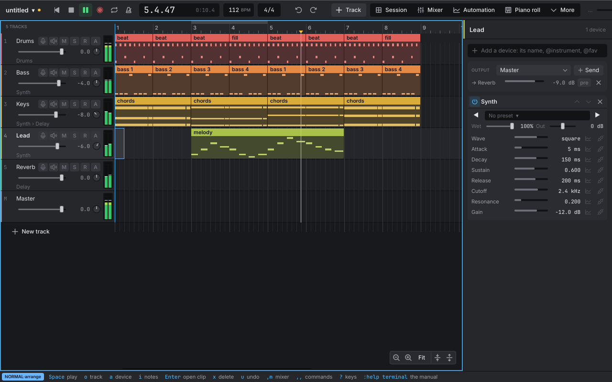
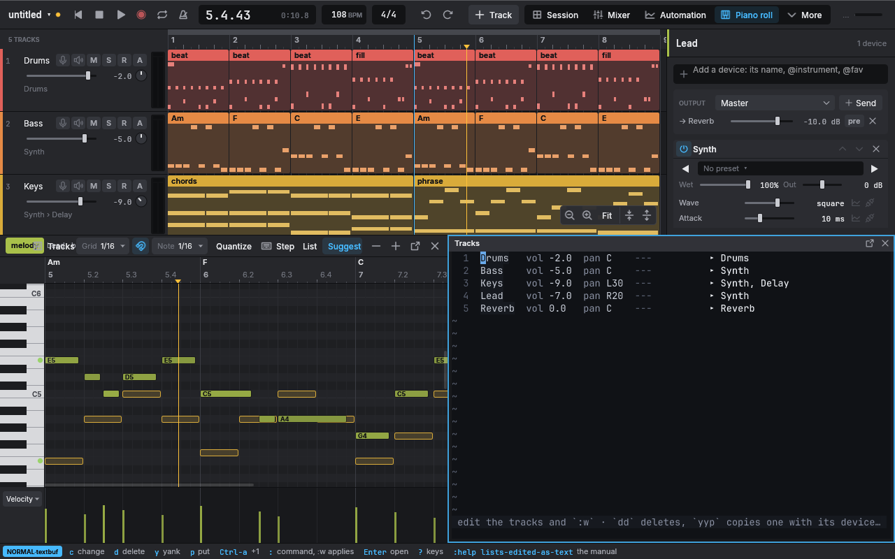
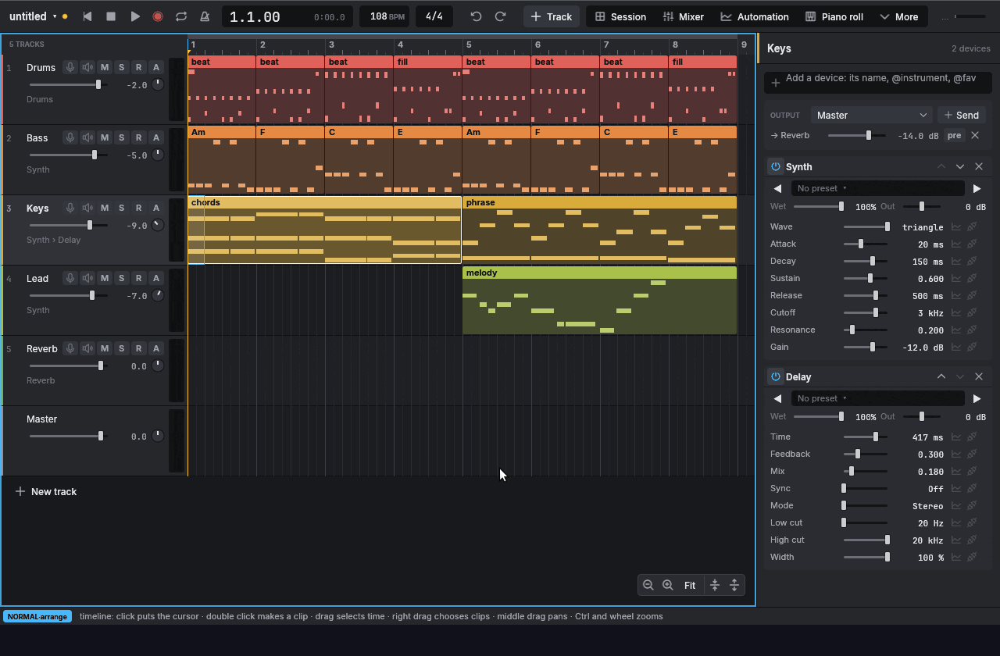
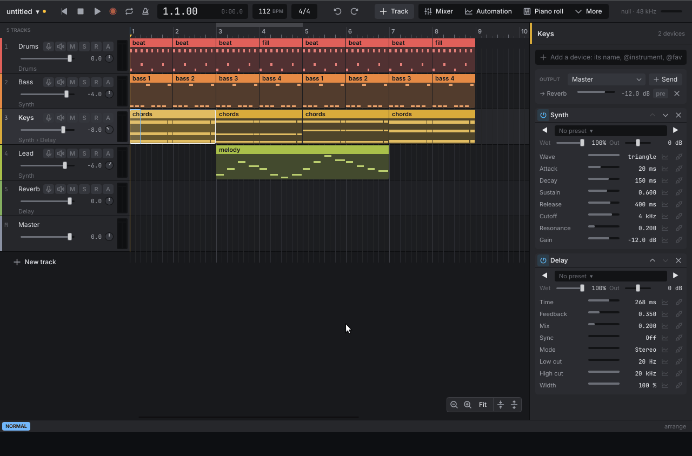
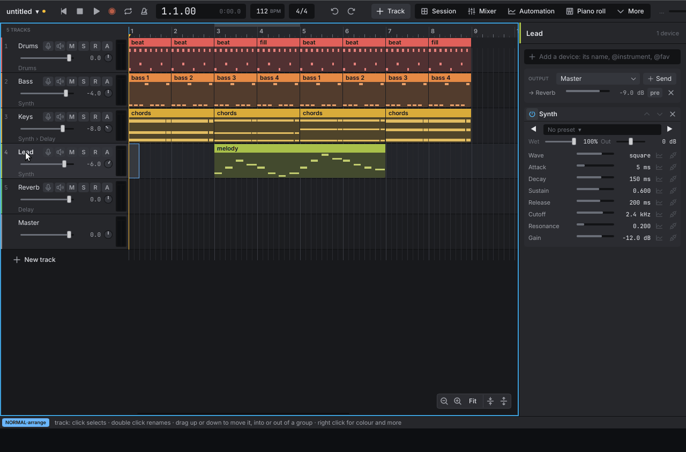

# paw-gui: the window

`paw-gui` is paw for the mouse: the same views the terminal shows, as panes
in a window, with faders you drag, clips you move and notes you draw. It is
written in Rust with [egui](https://github.com/emilk/egui) (eframe, OpenGL
through glow). paw is terminal first; the window is a second way to see and
touch the same project, and everything in it also works from the keyboard.



```sh
nix run .#paw-gui -- -e 'dofile("examples/demo-song.lua")'   # its own kernel, with a demo song
paw-gui song.json                                            # options are passed on to its kernel
paw --headless --listen /tmp/paw.sock & paw-gui --socket /tmp/paw.sock   # a running kernel
paw-gui --connect studio:7700 --token-file studio.token      # one on another machine, over TLS
```

## One view, two frontends

The window does not have views of its own to keep in step with the
terminal's. A view is written once, in Lua, and the kernel keeps a **scene**
of it for each window — what to draw, in cell units, with pictures and
roles — and sends the window only what changed (see "Scenes" in
[docs/protocol.md](../../docs/protocol.md)). The terminal draws the same
scene in cells (and kitty pixels); the window draws it with crisp text and
vector pictures. An extension's view therefore works in both with no code
for the window, and a test checks that the two agree for every view
(`tests/scene_parity.lua`). The mixer and the drum grid already draw from
roles (faders, meters, buttons) that the window renders as real widgets; the
arrange view and the piano roll still have native egui code that is being
moved onto scenes (see [docs/missing.md](../../docs/missing.md)).

## Pictures









## More

- [docs/window.md](../../docs/window.md) — every gesture, panes and pop-out
  windows, the renderer (`--renderer gpu|software`), fonts and CJK text,
  where the window keeps its size and place.
- Keys pressed in the window go to the same mappings as in the terminal.
- Tests: `cargo test --release -p paw-gui` runs in-process egui tests
  (egui_kittest) and drives the real window on a private X display.
- Licences: egui, eframe, winit and the rest are MIT / Apache-2.0 class; the
  bundled fonts are OFL (see `fonts/`).
