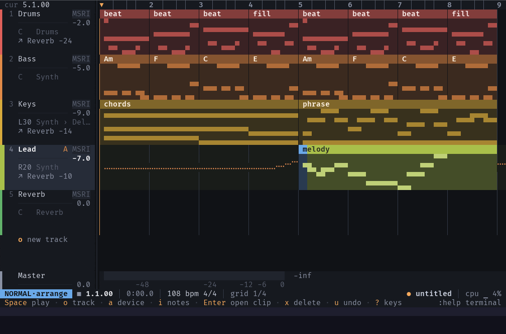
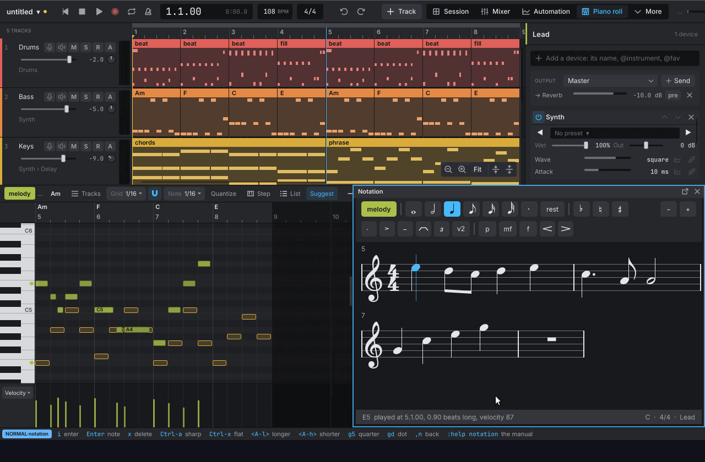
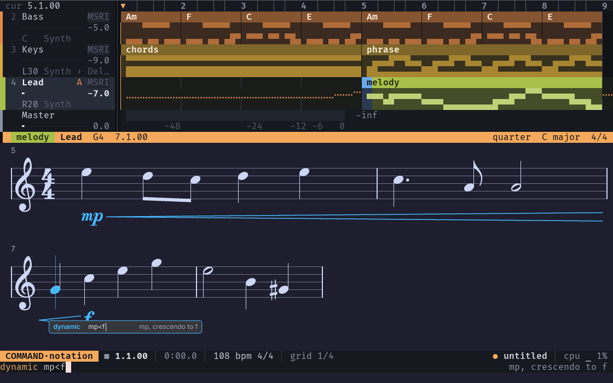
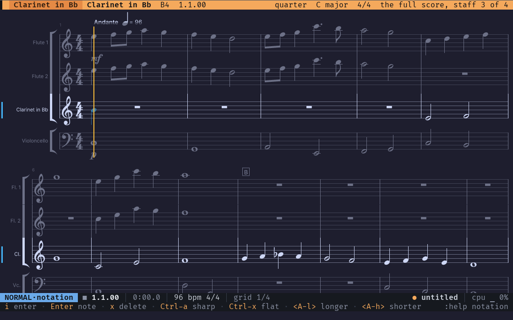
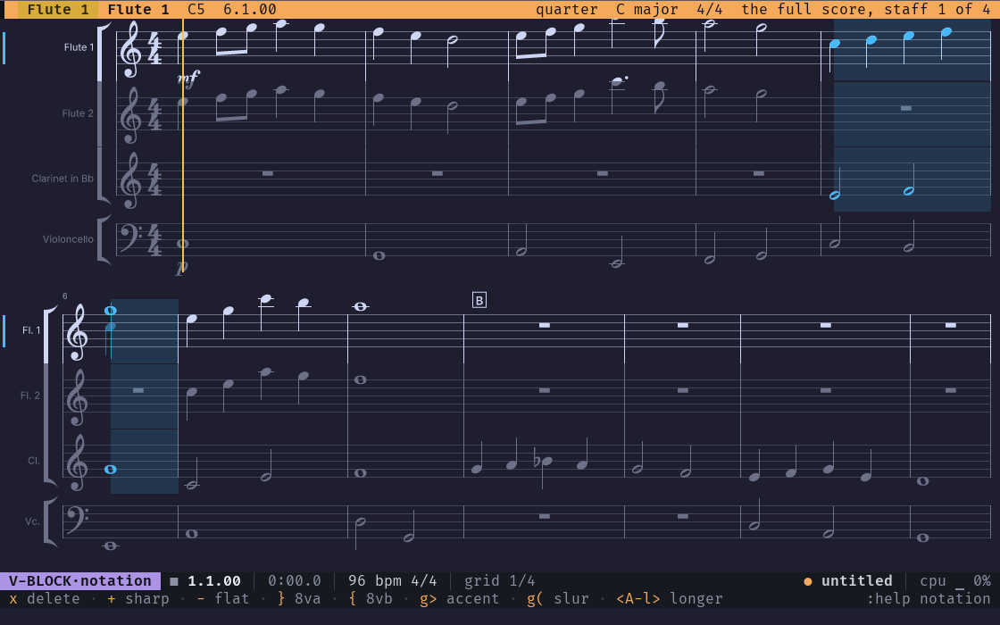
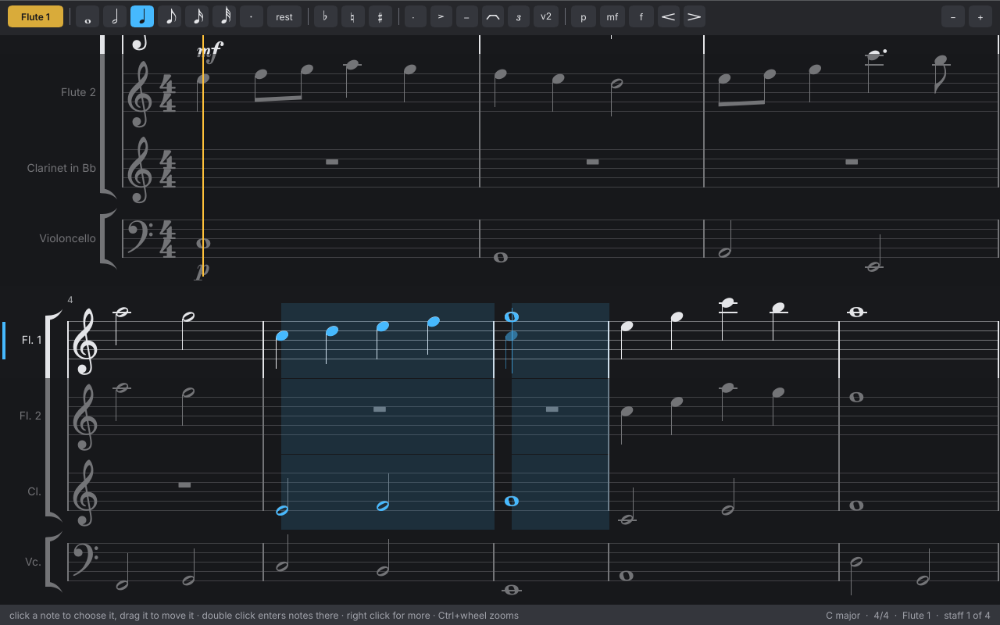
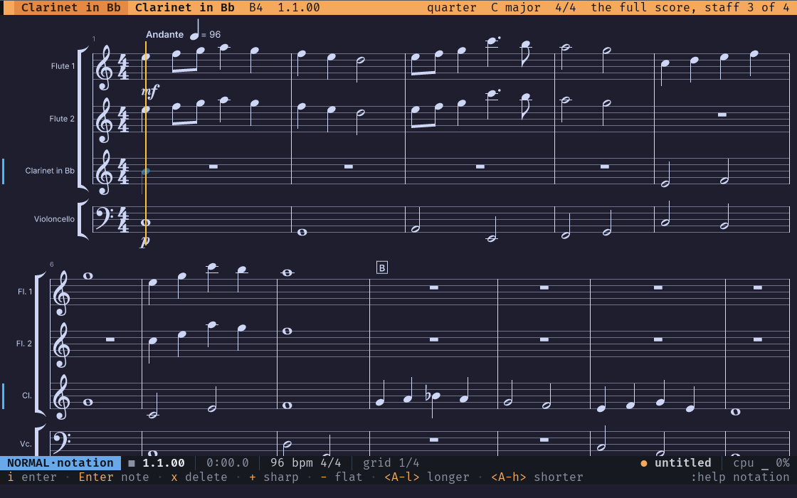
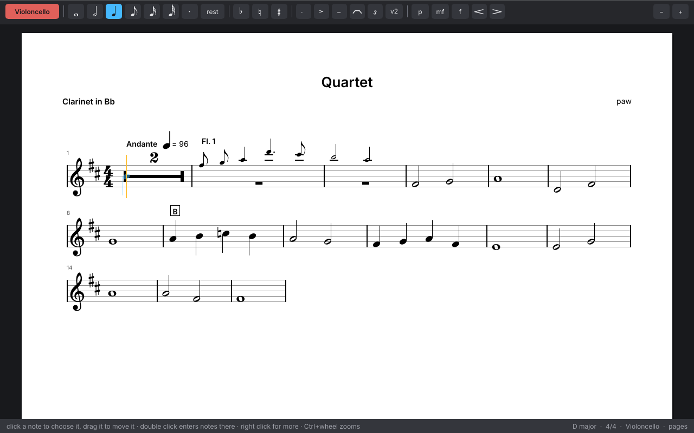

# notation

Staff notation for a clip, to read and to write: in the terminal, drawn in
text cells, and engraved with a music font (Leland) wherever there are
pixels: in a window of the graphical frontend, and on a terminal that shows
images.

Notation is a view of the clip's MIDI, as REAPER's notation editor is: the
notes are the truth, what plays and what every other view edits. The
score is those notes written as a musician would write them down, with
what you decide in notation (a spelling, a voice, a staccato, a dynamic)
kept beside them. Writing in notation edits the MIDI: a note entered is a
MIDI note where it is written and as long; a note raised, moved, made
longer or deleted is that MIDI note changed; each edit is one undo step,
and it changes no note it does not write.

```lua
paw.ext.load("extensions/notation")   -- or put it in ~/.config/paw/extensions
```







## Opening it

| | |
| --- | --- |
| `:notation` | the clip under the arrange cursor, or the piano roll's clip |
| `,n` | the same, in the arrange view and in the piano roll |
| Open as notation | in the window's right-click menu of a MIDI clip |

The view opens at the bottom of the terminal, taking two thirds of the
height, and in a window of its own in the graphical frontend. `,n` goes back
to the arrange view, as it came; `:q`, `ZZ` and `Ctrl-w c` close the view, and
so does closing the window. `Esc` in normal mode stays in the view, as it
does in Vim: it drops a count, an operator or a selection, and pressed again
soon it says how to leave.

## MIDI is the truth

Every MIDI clip opens as notation; there is nothing to convert first. The
score of a clip is made from its notes each time they change (written and
laid out again only in the bars that changed), with what notation keeps:

| Kept | Where | What |
| --- | --- | --- |
| on each note | `note.meta.notation` | its spelling (`letter`, `alter`, and the `pitch` it was spelled for: a note given another pitch in the roll is spelled by the key again), `voice`, `staff` of a grand staff, `grace` (`acciaccatura`, `appoggiatura`), `strum`, `chord`, `beam`, its chord's `art`iculations, `orn`ament and `stem`, `lyrics` of verses after the first (the first is `note.meta.lyric`, where the `utau` extension keeps its own), and `len` with `sounding`: how long it is written while it is as long as notation made it (a staccato) |
| with the clip | `clip.meta.notation`, in beats of the clip | `version`, how all this is laid out (1; a clip without one keeps it as before versions were written); the transcription's `settings`; `tuplets` written (or a stretch said to be plain); `marks` (dynamics, hairpins, slurs, text, tempo marks, chord symbols, playing techniques); `bars` (barlines, repeats, endings, rehearsal marks, key and clef changes, the beats' grouping); `layout` (system breaks, bars to a system); `staves`, the clefs it was written on where its notes would now choose others |
| with the track | `track.meta.notation` | its clef, its tablature |
| with the song | the tempo map, the signatures | what tempo marks and time signatures say |

Written notes are named by their MIDI notes (`n41` writes note 41, which
keeps its id however it is moved), and MusicXML written out carries those
names as each `<note>`'s `id`. Because what is kept is on the note, it goes where the note goes: moved,
copied, pasted or undone in the piano roll, a note keeps its spelling and
its voice, and a note deleted takes its own away. Marks along the clip
keep their beats.

**What an edit in notation writes.** Each is an ordinary edit of the
clip's notes (`paw.api.clip_notes_edit`), one undo step with what
notation keeps:

| In notation | The MIDI |
| --- | --- |
| a note entered | a note where it is written, as long as its written value (a tied note one note; a tuplet's on exact thirds or fifths; a grace note a 32nd before its note), as loud as the dynamic in force or as the piano roll enters notes |
| a pitch, a respelling, a step of the key | the note's pitch; its spelling kept on it |
| a chord moved, lengthened, dotted | its notes moved or made longer by as much as what is written, however they were played |
| a note or chord deleted, a bar taken out | the notes gone; the notes after a bar taken out moved earlier |
| a voice, a staff, a beam, an arpeggio sign, an ornament, a lyric | nothing in the MIDI: kept on the notes |
| a dynamic, a hairpin | the velocities of the notes it reaches (to the next dynamic), a hairpin ramping them (to its end, or to a dynamic written inside it, where it is drawn to end), `sfz` `fp` and the like at their place |
| an accent, a marcato | 20, 30 louder |
| a staccato, staccatissimo, tenuto, fermata | half, a quarter of its written length, all of it |
| a tempo mark, a time signature | the song's tempo map, its signature from that bar |

That is all a mark does: it writes the MIDI when it is written, and the
MIDI is then free. The piano roll can give a note marked `f` another
velocity, or a staccato note another length, and the mark stays, a label.
Taking a mark away puts back what it wrote where the note is still as the
mark left it, and leaves a note changed since alone; a dynamic taken away
puts back the loudness of the one before it. A slur, text, a repeat sign
or a playing technique writes nothing.

| | |
| --- | --- |
| `:notation.quantize`, `=` | quantize to the notation: each note starts where it is written and lasts as long as written (or as marked) |
| `:notation.apply-marks`, `g@` | make the notes play as the marks say again, after the piano roll changed them: dynamics and hairpins set the velocity, staccato and tenuto the length |
| `:notation.retranscribe`, `g=` | forget what notation decided about the notes (spellings, voices, hands, tuplets): written again from how they play |

**Projects from before.** A clip written in notation by an older version
kept a score of its own in `clip.meta.score`, its notes rendered from it.
Without this extension its notes play and edit as they are; with it the
clip shows as that score said, and the first edit in notation keeps what
the score said on the notes and the clip, the edit's undo step taking it
back.

## Works without the extension

Nothing in the core knows of notation. Without this extension a clip
written in notation is a MIDI clip like any other: its notes play, and the
piano roll, Ex, the language servers, MIDI export and every other view edit
them as they are. What notation keeps rides along with them: on a note
copied or pasted, on the clip moved or duplicated, saved with the project.
Loaded again, notation shows the notes as they are now, with what it kept
on the notes that are left; and an edit in notation changes only the notes
it writes.

## Coming from REAPER

The model is REAPER's: MIDI is the item's, and notation shows it, with
what it cannot say kept as notation data on the notes (REAPER's
"notation events": spelling, voice, articulation, text) and with the item
(dynamics, clefs, key signatures). Entering in notation writes MIDI; a
dynamic sets the velocities of the notes after it when it is written, as
REAPER's does when it is set to; the piano roll edits the same notes. What
differs: the transcription here reads played music for itself (strums,
swing, drift, voices, hands, grace notes, tuplets) rather than quantizing
for display only, and its settings are the clip's (`:notation.set`).

## The piano roll beside it

The roll edits the same notes, and nothing asks or refuses: it is a plain
MIDI editor. With the roll and the notation view both on screen, on one
clip and both `:setlocal timebind`, the note under one's cursor is outlined
in the other (`⟦ ⟧` in the roll, a `◉` head in the staff), found by the
note's id.

## What is written of a MIDI clip

Between a clip's notes and the page is a transcription (`notation.score`):
the notes are transcribed into written chords, each knowing which played
notes it stands for, and with what notation keeps they are the score
(`notation.midi`). Everything the score does not show (each note's offset
from its written place, its real length, its velocity) stays in the notes as
played.

- **Chords and strums**: onsets within 35 ms are one chord in any order; a
  strum or a roll (each string up to 70 ms after the last, low to high or high
  to low, the earlier ones still ringing, at most 450 ms) is one chord too,
  written where it starts. A roll slower than 160 ms gets an arpeggio sign
  with its direction.
- **Onsets** go on the simplest grid that explains each beat: the beat, its
  halves, quarters or eighths, triplets or sixths, or fifths and sevenths
  (in 6/8 the beat's eighths, or two or four in its time), chosen per beat
  by how well it fits against how complex it is. A tuplet has to fit
  clearly better than the straight grid, its notes no shorter than the
  `finest` value, and a lone one among plainly duple beats needs more to
  convince: a straight part played loosely is not written in tuplets.
- **Drift**: the player's distance from the grid is followed, first beat by
  beat and then by a line fitted through the onsets around each beat, so a
  part played ahead of the beat or slowing down (a ritardando against the
  grid) is still written on the beat.
- **Swing**: eighths played long-short are recognised and written straight.
- **Lengths**: a chord lasts to the next onset in its voice when the silence
  before it is short (articulation, not a rest); a note much shorter than
  that, within a beat, is a staccato; a note held into the next is legato,
  not a tie; otherwise the value nearest what was played, by proportion, so
  a long note let go early is still a long note.
- **Grace notes**: a note shorter than 100 ms (and a sixth of a beat) just
  before a longer note of another pitch, let go by the time it sounds, and
  not a step of an even run (a fast tuplet's last note).
- **Voices**: a note held well past the next onset under (or over) notes
  that move is a second voice, stems down (or up), with its own rests.
- **Hands**: on a grand staff each chord's notes are split between the hands
  by where each hand has been, so a melody that goes below middle C stays in
  the right hand.
- **Tuplets** are bracketed with their number: `3` for triplets (quarter-note
  triplets over two beats are one bracket), `6` for a beat of sixteenths in
  sixes, `5` and `7` for quintuplets and septuplets of sixteenths (in the
  time of four), and in 6/8 `2` for a duplet and `4` for four eighths in
  the time of three. A tuplet said in notation (`,3`, `gt`) is kept over
  what the notes would suggest, and so is a beat said to be plain.
  **Rests** are merged as the metre divides the bar.
- Notes drawn exactly on the grid (in the piano roll) are written as they
  are: the interpretation is for what was played. A played note that lands
  on the grid by chance (a MIDI file's ticks allow it now and then) is
  read as played, unless the notes beside it are drawn too or notation
  wrote it.

Each of these has a setting, kept with the clip in `clip.meta.notation.settings`:

| `:notation.set` | default | |
| --- | --- | --- |
| `chord` | 35 | ms: onsets this close are one chord |
| `strum`, `strum_span` | 70, 450 | ms between strings of a strum (0 off); its longest |
| `arpeggio` | 160 | ms: a strum this long gets an arpeggio sign (0 never) |
| `triplets` | on | beats may be written in triplets (duplets and quadruplets in 6/8) |
| `tuplets` | on | beats may be written as quintuplets and septuplets |
| `finest` | 0.25 | the shortest duple subdivision, in beats |
| `simplicity` | 1 | how strongly simple grids are preferred (0 to 2) |
| `gap` | 0.3 | a silence shorter than this share of the time to the next onset is articulation |
| `staccato` | on | short detached notes written with a staccato mark |
| `grace` | 100 | ms: the longest grace note (0 off) |
| `swing` | auto | `auto`, `off`, or the long eighth's share of the beat (0.66) |
| `voices` | on | held notes as a second voice |
| `split` | auto | or a pitch: the hands split there |
| `follow` | on | follow the player's drift from the grid |
| `mode` | score | `raw`: every note as played, rounded to `paw.opt.notation_grid` |

`:notation.set` alone lists them on a page, with the default of each the clip changed, `:notation.set swing off` sets one,
`:notation.set swing default` forgets it, `:notation.reset` forgets them all.
`:notation.raw` (`gR`) switches the raw view on and off: every note as it is,
rounded to the grid, one chord per start, middle C splitting the hands, for
checking.

**What you decide** is kept, and survives changes made elsewhere (see
[MIDI is the truth](#midi-is-the-truth)): a note's voice, hand, spelling,
articulations, a grace note or not, a strum's arpeggio sign, notes that are
one chord, a broken beam; the clip's tuplets, marks and bars. Notes entered
in notation are drawn exactly on the grid and written as they are; a note
marked staccato keeps its written length while it is as short as the mark
made it. A tie is not kept: a tied note is one note, written again as the
metre divides it.

The rest of the page:

- **Measures** follow the song's bars. Where the kernel keeps time signatures
  along the song (`paw.time.signature_at`), each bar takes its own, and the
  new signature is written where it changes.
- **Clef**: treble when the notes stay above A3, bass when they stay below
  E4, a grand staff when they need both. `:notation.clef bass` fixes it for
  the track (`treble`, `treble8` for guitar, `bass`, `bass8`, `alto`,
  `tenor`, `grand`, `auto`), kept in `track.meta.notation`. A clip written
  in notation keeps the clefs it was written on where its notes would now
  choose others (a melody taken a little under the treble staff stays on
  it), and a clef change at a bar (`\C`, see Popovers).
- **Key**: the project's key, as the `musicops` extension keeps it in
  `project.meta.musicops`; modes and minor keys take the signature of their
  relative major. `:notation.key Eb major` sets it, `:notation.key off`
  clears it; with a clip open in the view it writes a key signature from
  the cursor's bar (`\k`, see Popovers), and the first bar's is the
  project's key too. With no key set, the title names the minor key the
  music is read in (`A minor` rather than `C major`); in a song of more
  than 2000 notes that reading is done once the edits pause, as it takes
  a while, and the title follows a moment later.
- **Spelling**: notes of the key take its letters; the others lean the way
  the key does. Accidentals are remembered to the end of the bar, a tied
  note keeps its accidental across the barline without a sign, and a note
  altered in one bar is reminded back in the next.
- **Stems** go by the note furthest from the middle line, or by the voice;
  **beams** join eighths and shorter within a beat (four eighths in half a
  4/4 bar, three in 6/8), within a tuplet, with part beams.
- **Tablature**: `:notation.tab guitar` (or `bass`, `dropd`, `dadgad`,
  `7string`, `bass5`, or the strings' notes from the lowest, `E2 A2 D3 G3 B3
  E4`) puts a tab staff under the track's notation, kept in
  `track.meta.notation.tab`, and writes a guitar in its treble clef an octave
  up. Each chord's notes go on different strings within a hand's reach,
  moving the hand as little as possible; `meta.notation.string` on a note
  fixes its string.
- **Lyrics**: a note's `meta.lyric` (the `utau` extension's vocal clips keep
  theirs there) is written under it.
- **Several tracks**: `:notation.tracks` (`gT`) shows every track with MIDI
  over the open clip's stretch as a score, a staff each, the open clip's the
  one edited; the same again goes back to the clip alone. Every track, a
  group's or a selection's are in [The score](#scores), the parts in
  [Parts](#parts).

## Keys

In the notation view. Counts, registers, `.`, macros and marks work as
everywhere. The operators and text objects work on the written score (see
[The grammar](#the-grammar)); the view's rows are pitches, so a visual
selection and the roll's single keys on it work as in the piano roll. Every
key that edits writes the clip's MIDI (see
[MIDI is the truth](#midi-is-the-truth)), one undo step.

<!-- tags: g3 g4 g5 g6 -->

| Keys | |
| --- | --- |
| `h` `l` | back, on by the chosen value |
| `j` `k`, `Ctrl-d` `Ctrl-u` | down, up a line or space; an octave |
| `w` `b` `e` | next, previous note or rest; end of the note |
| `W` `B`, `0` `^` `$`, `gg` `G` | next, previous bar; start of the clip, first note, end; the highest, lowest note's line |
| `Enter` | add a note of the chosen value at the cursor, or take away the one there |
| `x` | delete the note under the cursor |
| `+` `-`, `Ctrl-a` `Ctrl-x` | sharpen, flatten it (a semitone, spelled with a sharp or a flat); a count first is how many |
| `Alt-k` `Alt-j` | move it up, down a step of the key |
| `}` `{` | move it up, down an octave |
| `Alt-l` `Alt-h` | lengthen, shorten its chord by the chosen value, ties included |
| `g.` | dot its chord, or take the dot away |
| `g2` … `g7` | choose the value: 32nd, 16th, eighth, quarter, half, whole (the numbers MuseScore uses) |
| `gd` | dotted values on or off |
| `d` `y` `c` `>` `<` `=` `gl` | operators: delete, yank, change, move later or earlier by the chosen value, quantize the notes to the notation, loop; the rest are in [The grammar](#the-grammar) |
| `v` `V` `Ctrl-v`, then `x` `Ctrl-a` `Ctrl-x` `Alt-k` `Alt-j` `}` `{` | on a selection, which takes in the note under the cursor, as Vim's takes the character |
| `:` on a selection | a command for it: the line starts `:'<,'>` (`:'<,'>notation.cresc`) |
| `p` `P` | paste after the note, at the cursor (a bar yanked with `yab`: after, before the cursor's bar) |
| `i`, `a`, `I`, `R` | enter notes at the cursor, after the note; pushing later music along; re-pitching what is there |
| `gh`, `gp` | hear the cursor's pitch; playhead to the cursor |
| `zi` `zo` | spread the notes out, draw them closer; in the cell view zoomed in, a row for every line and space; on the engraved page, a larger, smaller staff |
| `zg` | the engraved page as one long system scrolled sideways (the galley), or wrapped |
| `zp` | the engraved systems on pages of paper, under the title and composer (the page view), or without pages |
| `zs` | start a system at the cursor's bar; again, let the bar go where it fits |
| `zj` | keep the cursor's bar on the system before; again, let it go where it fits |
| `:notation.bars-per-system 4` | that many bars on every system; without a number, as they fit |
| `K` | what is under the cursor: the note as written (its value, voice, marks and the dynamic in force) and the MIDI note it is, then the clip and the track |
| `,n` | back to the arrange view |
| `:q` `ZZ` `Ctrl-w c` | close the view |
| `Esc` | stay: drop a count, an operator or a selection |

**Entering notes** (`i`), the way notation programs do it: a letter `c` to
`b` enters that note at the cursor with the chosen value, in the octave
nearest the note before (within a fourth), as the key alters it, and steps
on; a capital stays, to build a chord (`CEg`). Notes go into a voice of
the staff the note is written on: the voice of the note the cursor is on at
`i` (else the one chosen, 1 unless `v` or `:notation.voice` says), over what
that voice had there: a chord it cuts into keeps what is before, the rest
of it is a rest; a note longer than what is left of the bar is tied over
the barline. No other voice and no other staff is touched.

| Keys | |
| --- | --- |
| `a` … `g`, `A` … `G` | enter a note and step on; enter it and stay |
| `2` … `7` | choose the value |
| `.` | dotted values on or off |
| `+` `#`, `-` | sharpen, flatten the note just entered |
| `'` `,` | the note just entered an octave up, down |
| `Alt-2` … `Alt-8` | add a second … an octave above the note just entered, in the key, to its chord (`C` `Alt-3` `Alt-3` is a C major triad) |
| `~` | hold the note just entered on by the chosen value, tied where it crosses a beat or a barline, and step on |
| `t` | enter triplets of the chosen value (a triplet of rests is made where there is none, and filled), or plain values again |
| `v` | enter in the other voice (1 or 2); `:notation.voice 3` chooses any of four |
| `R` | enter the last chord (or note) again here, and step on |
| `r` `0` | a rest: clear the chosen value and step on |
| `Space` | step on, leaving what is there |
| `Backspace` | step back and remove what starts there |
| `Esc` | back to normal mode |

## The grammar

A Vim grammar for music: an operator, then a motion or a text object, with
counts, registers, `.` and undo as everywhere. Text objects are found in
the score (events, measures, voices), not among notes in time, and every
operator changes the written score and so the notes it writes, so `d3ab`,
`gUip`, `y2iv` and `.` after any of them are exact and each is one undo
step. A motion acts in the cursor's staff and voice; a visual selection in
every staff and voice (a block in its pitches).

<!-- tags: i. a. iv av -->

| Object | `i…` | `a…` |
| --- | --- | --- |
| note `n` | the note under the cursor | with the notes its ties join |
| chord `c` | the chord (`3ic` three) | with its grace notes and ties |
| beat `.` | the beat, in the cursor's voice (`2i.` two) | the beat in every staff and voice |
| bar `b` | what the bar holds, every staff and voice (`2ib`) | the bar itself: `dab` takes it out and the music closes up, `yab` then `p` or `P` puts it in after or before the cursor's bar |
| phrase `p` | the notes under the cursor's slur, else between the rests around it (`2ip`) | with the rests after it |
| voice `v` | the cursor's voice in the bar (`2iv`) | the voice through the score |
| staff `s` | every voice of the staff in the bar | the staff through the score |
| tuplet `t` | the tuplet's notes | the tuplet, rests and all |
| slur `l` | the notes under the slur | and the slur |
| clip `e` | the whole clip | the whole clip |

`ic` is the chord here; in the piano roll it is the clip, which in notation
is `ie` (as in the piano roll too).

| Operator | |
| --- | --- |
| `d` `y` `c` | delete (chords become rests, notes leave their chords, bars go), yank (a fragment of the score, which pastes as written here and as played in the piano roll), change |
| `>` `<` | move later, earlier by the chosen value, as written: the notes move by as much, with their marks, what is there gives way |
| `gU` `gu` | up, down a step of the key, keeping chromatic notes chromatic; a count is the steps (`3gUib` a fourth up) |
| `g+` `g-` | up, down a semitone, spelled as the key has it (an octave keeps the spelling); a count is the semitones |
| `g~` | respell each note: G sharp, A flat, G sharp again; E, F flat (`g~in` the note under the cursor) |
| `g(` | a slur over the notes (`g(ip`, `g(3w`; on a slur's start again, taken away; on a selection too). `s` is solo wherever there is a track |
| `g?` | retrograde: backwards, rhythm and pitches, grace notes with their chord; with a count (`2g?ib`) an inversion about the first note, in the key |
| `gq` | tidy: spelled as the key has it, beams as the metre has them, values and ties written again as the metre divides the bars |
| `!` | filter: asks for a filter, `reverse`, `transpose 12`, `rhythm 1/8`, or any shell command, which reads the music a line an event (`1/4 C4 E4`, `1/8 r`, lengths as parts of a whole note) and writes it back so: `!ib tac`, `!ip sed s/D4/G4/` |
| `=` `g=` `gl` | play as written, write again from the playing, loop |

| Motion | |
| --- | --- |
| `f` `F` + letter | to the next, previous note of that name in the voice (`2fe`); with an operator the note found is taken in, as Vim's `df` |
| `t` `T` + letter | to the note before (after) it |
| `;` `,` | the last `f` `F` `t` `T` again, the other way. `,` is also the leader: alone it lists the leader keys and waits a few seconds for one, then moves; `,` followed by a key no leader map has moves at once. The popovers are on the local leader (`\`), so every `,` key means here what it means everywhere |
| `)` `(` | the next, previous phrase: a note after a rest |
| `]v` `[v` | the next, previous voice (then the next staff's); entering goes into it |
| `Ctrl-j` `Ctrl-k` | the staff below, above |

**Entry modes.** `i` writes over what is there in its voice (as MuseScore
and Dorico do by default). `I` pushes: what comes later in the voice moves
along by what is entered, over barlines (Dorico's Insert); `Insert` toggles
between the two while entering. `r` and a letter re-pitches the note under
the cursor (or its chord's top note) to the nearest note of that name and
keeps its rhythm (`3rc` three chords). `R` is re-pitch mode: each letter
makes the next chord of the voice that note, keeping the rhythm, and a
capital adds a note to it; copy a rhythm, then `R` and the letters (in this
view `R` is not record). The insert mode badge says `INS`, `PUSH` or
`REPITCH`, and a tuplet or grace note to come.

| Keys in insert mode | |
| --- | --- |
| `/`, `//` then a letter | a grace note before the note at the cursor: an acciaccatura, an appoggiatura |
| `Ctrl-t` | a tuplet to enter: `3` (three in the time of two), `5` (in four), `5:4`, `2:3`, `off` |
| `Ctrl-o` | one command of normal mode, then back to entering |
| `Ctrl-r` and a register | paste it at the cursor and step past it (`Ctrl-r "`) |
| `Tab` | take the suggestion `paw.complete` shows as ghost notes; in normal mode `3 Tab` takes three notes or chords of it (with none shown, `Tab` is the next view) |

**Ex.** `:s`, `:g` and `:d` over notes change the clip's notes as they do
in the piano roll, and the score shows them: `:%s/c4/db4/g` raises the C4s
a semitone, spelled as the key has it; `:g/e4/d` deletes the E4s.

**Editing the score.** These work on the written chord under the cursor;
its notes move and lengthen by as much as what is written, however they
were played:

| Keys | |
| --- | --- |
| `L` `H` | move the chord later, earlier by the chosen value, with its grace notes and marks; what is there in its voice gives way |
| `Alt-l` `Alt-h` `g.` | its written length longer, shorter, dotted, ties included |
| `X` | delete the chord: a rest (`x` deletes the one note) |
| `=` | an operator: the notes quantized to the notation, starting where they are written and as long, e.g. `=in`, `=ib`, or on a selection |
| `g=` | an operator: what notation decided about the notes forgotten, the bars written again from how they play |
| `gv` | the note (or the chord) into the other voice, and enter in that voice |
| `gH` | the chord onto the other staff of a grand staff, in a voice free there |
| `gs` | arpeggio sign up, down, none; on a selection, the chords one chord (a strum) |
| `gG` | the chord a grace note of the next (its time goes to the chord before), or the chord's grace notes notes again |
| `gb` | break the beam before the chord, or join it |
| `gt` | the beat in triplets (a duplet in 6/8), or not: the bar written again so |
| `g'` `g>` `g_` `g^` | staccato, accent, tenuto, marcato on the chord (or a selection), and played so |
| `g(` | on a selection: a slur, the notes played legato (it is the slur operator: `g(ip`) |
| `Alt-l` `Alt-h` | on a selection: each chord longer, shorter by the chosen value |
| `gR` `gT` | the raw view; several tracks |

`:notation.quantize` quantizes the whole clip to the notation,
`:notation.retranscribe` writes it again from how it plays.
`:notation.transpose 2` moves the chord under the cursor up two semitones,
spelled by the key (`-1 steps` a step of the key down).

**Ranges.** Every `notation.*` command that works on notes or places marks
takes a range in front, as in Vim: `:'<,'>` the last selection (what `:`
types from visual mode), `:5,8` bars 5 to 8, `:5` bar 5. So
`:5,8notation.transpose 2`, `:'<,'>notation.slur`, `:9notation.dyn p`,
`:1,4notation.repeat` (both signs around bars 1 to 4), `:5,8notation.quantize`.
The commands that take one are `art`, `dyn`, `cresc`, `dim`, `slur`, `text`,
`repeat`, `quantize`, `apply-marks`, `retranscribe`, `transpose`, and those the popovers
run: `tempo`, `meter`, `key`, `clef`, `bar`, `rehearsal`, `chord`, `lyric`,
`orn`, `tech`, `interval`, `tuplet` and `voice`.

| Command | |
| --- | --- |
| `:notation.open` | show the clip under the cursor as notation (as `:notation`) |
| `:notation.value eighth` | the value notes are entered with (`g2` … `g7`) |
| `:notation.art accent` | staccato, accent, tenuto or marcato on the chord or the range |
| `:notation.orn tr` | an ornament: `tr`, `mordent`, `prall`, `turn`, `fermata`, `trem`, `off` |
| `:notation.tech pizz.` | a playing technique, written: `pizz.`, `arco`, `con sord.`, `off` |
| `:notation.bar :\|` | a barline at the cursor or the range's end: `\|\|`, `\|.`, `\|:`, `:\|`, `:\|:`; endings `1.` `2.` over the range; `off` |
| `:notation.meter 6/8` | the time signature from the cursor's bar, the music written again in its bars (`3+3+2/8`, `C`) |
| `:notation.rehearsal` | a rehearsal mark at the cursor's bar (the next letter), and a song marker |
| `:notation.chord Cmaj7` | a chord symbol at the cursor (`G/B`, `N.C.`, `off`) |
| `:notation.lyric la-` | a syllable under the note at the cursor; `verse=2` for the second verse |
| `:notation.interval 3` | a note an interval above (`-6` below, `m3`) each chord of the range |
| `:notation.tuplet 3` | the beat or the range as a tuplet (`5:4`); in insert mode, enter in it (`off` plain) |
| `:part.bars-per-system 4` | in the part shown, that many bars to every system; without a number, as they fit |

**Marks that play.** `:notation.dyn mf` puts a dynamic at the cursor (`ppp` to
`fff`, `off`): the velocities of the notes from there to the next dynamic
are set to its loudness. `:notation.cresc` and `:notation.dim` put a
hairpin over the selection or range (or to the end of the bar), which ramps
the velocities to the next dynamic. `:notation.slur` slurs the selection.
`:notation.text Allegro` writes text above the staff, and
`:notation.repeat start` (`end`, `off`) a repeat sign at the cursor's bar;
these three are written only (the song's timeline plays as it is). A
staccato makes a note half its written length, a tenuto all of it, an
accent 20 louder, a marcato 30. Each writes the MIDI when it is written;
after that the notes are free to change (see
[MIDI is the truth](#midi-is-the-truth)).

**Marks follow notation edits.** A note entered, moved or pasted in
notation takes the loudness the marks ask where it lands: the dynamic in
force, a hairpin's ramp there, an accent's push; a note that stays under the
same marks keeps the velocity it has, and a note no edit touched is never
changed (a piano roll edit is left alone by a notation edit elsewhere). To
bring back MIDI that drifted from the marks, `:notation.apply-marks` (with
a range, `:5,8notation.apply-marks`, or on the selection) writes what the
marks ask into the notes it covers, one undo step, and `g@` and a motion
or selection (`g@ib`, `vjg@`) does it with a prompt: while it is open the
change is heard and drawn in the accent, `Enter` writes it and `Esc` leaves
nothing. It does it again to no effect (an accent is not added twice), and
taking a mark away afterwards puts back what the note had before it was
applied.

## Popovers

Everything that is not a note is written with a popover, as in Dorico,
in the shape of a Vim prompt: the local leader (`\`, option `paw.opt.localleader`) and a letter opens a
one-line prompt at the caret. In visual mode it is for the selection; in
insert mode `Ctrl-o` comes first (`Ctrl-o \d`), and entering notes goes on
after it. `Tab` completes, each choice with what it means; `Up` and `Down`
go through what was typed before in that popover; while it is typed the
page shows what it would write in the accent's ink (and you hear it: it is
a trial, `paw.audition`), and the line says what it would do or why it
cannot. `Enter` writes it, one undo step; `Esc` leaves no trace.

Each popover is an Ex command with what was typed after it, run with the
selection's range when there is one: `\d` `mp<f` on a selection runs
`:'<,'>notation.dyn mp<f`. So `.` writes it again at the cursor, `@:`
runs the line again, a macro records it, and `:5,8notation.dyn p` or
`:9notation.tempo rit.` say the same without the popover. `\.` opens the
last popover again with what was typed in it.

| Keys | Popover | Accepts | Writes |
| --- | --- | --- | --- |
| `\d` | dynamics | `mp`, `sfz`, `fp`, `p subito`, `mp<f`, `<`, `>`, `niente<`, `off` | a dynamic at the cursor (the start of the selection); a hairpin over the selection, or to the next dynamic when there is no selection, and the dynamic it reaches. `sfz` `sf` `fz` `rfz` accent the notes there, `fp` `sfp` are loud there and soft after |
| `\t` | tempo | `Allegro q=132`, `q.=60`, `Andante`, `rit.`, `accel.`, `a tempo`, `off` | a tempo mark, and a point of the song's tempo map: `rit.` and `accel.` ramp a fifth slower or faster to the end of the selection (or the bar), `a tempo` goes back to the last tempo marked; a word alone has its tempo (Allegro 132) |
| `\m` | time signature | `6/8`, `3/4`, `3+3+2/8`, `C`, `¢` | the song's signature from the cursor's bar: every note stays where it is and is written in the new bars, tied over the new barlines; a grouping (`3+3+2/8`) and `C` `¢` kept with the clip |
| `\k` | key | `Eb`, `f#m` (a small letter is minor), `D dorian`, `off` | a key signature from the cursor's bar; in the first bar, the project's key too |
| `\C` | clef | `treble`, `bass`, `alto`, `tenor`, `treble8`, `bass8` | a clef change at the cursor's bar on its staff; in the first bar, the track's clef |
| `\b` | barlines, repeats, endings | `\|\|`, `\|.`, `\|:`, `:\|`, `:\|:`, `1.`, `2.`, `off` | at the cursor's barline (the one before the bar when the cursor is at its start, else after it); an ending over the bars of the selection |
| `\X` | text | `dolce`, `Solo` | text over the staff |
| `\r` | rehearsal mark | `A`, `Intro`; Enter alone writes the next letter | a boxed mark at the bar, and a marker of the same name in the song |
| `\q` | chord symbols | `Cmaj7`, `G/B`, `F#m7b5`, `N.C.` | over the staff; `Space` writes it and goes to the next beat, the prompt still open; `Tab` offers first what the notes there sound (`paw.harmony`) |
| `\l` | lyrics | a syllable; `Space` the next note, `-` a hyphen, `_` an extender; `verse=2 ` first for verse 2 | under the note at the caret, and on to the next of its voice |
| `\i` | intervals | `3`, `-6`, `8`, `m3`, `M6`, `P5` | a note that far above the top (below the lowest) note of each chord of the selection, in the key |
| `\3` | tuplets | `3`, `5`, `5:4`, `7:8`, `off` | the beat at the cursor (or the selection) as that tuplet; in insert mode, the notes entered next |
| `\v` | voice | `1` to `4` | the voice notes are entered in; with a selection, its chords moved into it |
| `\o` | ornaments | `tr`, `mordent`, `prall`, `turn`, `fermata`, `trem`, `off` | on the chord, or each chord of the selection; a fermata holds its note's whole value |
| `\p` | playing techniques | `pizz.`, `arco`, `con sord.`, `sul pont.` | text at the cursor (written only) |
| `\.` | the last popover again | | with what was typed in it |

The letters are Dorico's where Dorico's is not a note name. They sit on
the local leader (`\`) and not on the leader (`,`), so that the leader keeps
its meaning in the notation view: `,d` is the device panel, `,m` the mixer,
`,l` the session view and `,p` the piano roll there as everywhere, and `,c`
and `,x` start `,ca` (fixes and actions) and the mix measurements as they do
elsewhere. The clef is `\C` and text `\X`.
`\.` repeats the last popover. Change the local
leader with `paw.opt.localleader`; a key of a view of your own that would
sit on a leader key of the whole program belongs on `<localleader>` too (the
key rule's check says so).

The prompt is drawn under the caret's system in the terminal and on the
engraved page (in a window, and on a terminal's pixel surface), so that what
it previews stays in sight, and only there: the window's status line does
not repeat it. Before anything is typed it shows examples of what to type,
dim; `Tab` offers the choices.

**Coming from Dorico.** The popovers are Dorico's (Shift and a letter
there, the local leader and a letter here), with the same words: `mp<f`,
`p subito`, `niente<`, `Allegro q=132`, `rit.`, `a tempo`, `3+3+2/8`,
`f#m`, `|:`, `1.`, `5:4`. What differs: there is no Write and Play mode,
since the piano roll on the same clip is Play mode: both edit the clip's
MIDI; a popover with a selection works on all of it, and its
line is an Ex command you can type, repeat and record. **Coming from
MuseScore**: the popovers stand for MuseScore's palettes and the
`Ctrl-E`/`Ctrl-T`/`Ctrl-K`/`Ctrl-L` text entries; lyrics and chord
symbols go on with `Space` as there, and `-` hyphenates.

## The staff in cells

Where the terminal cannot show pictures (tmux, a plain terminal, a remote
shell) the staff is drawn in text cells, in characters every common
monospace font has (DejaVu Sans Mono, JetBrains Mono, Fira Code, Noto Sans
Mono). The staff lines run unbroken from the clef to the end of the system
and the barlines join them (`┬ ┼ ┴`); a grand staff has a brace. Heads are
two cells wide, filled (`██`) or open (`()`), with their stems up from the
right side and down from the left, flags (`╲ ╱`) or beams (`━`) at the tips,
dots after them, accidentals before them and ledger lines through or under
them. Rests look like rests: the whole hangs from the fourth line and the
half sits on the third (`▄▄` `▀▀`), the quarter zigzags (`╲ ╱ ╲`), an eighth
is a `7`, a sixteenth two. Ties and slurs are arcs (`╰──╯`, `╭──╮`), tuplets
a bracket with their number, dynamics and hairpins under the staff (between
a grand staff's two), a hairpin running on over barlines to where it ends.
Notes low under the last staff with their stems down get rows of their own
under it, so that nothing runs into the next system; the popover's prompt
opens under the row of dynamics, so that a dynamic it previews stays in
sight.

At the usual zoom the staff is dense: each line has a row and each space is
between two rows, so a staff takes five rows and a grand staff, with room
for two ledger lines and the stems, eighteen. A head in a space is drawn
across the rows either side (`▄▄` over `▀▀`, an open one `╭╮` over `╰╯`).
`zi` opens it out to a row for every line and space, nine a staff, which is
easier to read and lets the pointer reach the spaces; `zo` goes back. A
panel too low for both staves of a grand staff shows the cursor's. With
`paw.opt.ascii` the staff is drawn open in plain ASCII (`-` `|` `+`, heads
`@@` and `()`, `#` `b` `n`, the treble clef `&`, the bass clef `?:`, a C
clef `B`). A clef or key that changes inside a system is drawn at the
bar, the clef smaller; a key's old signs are cancelled with naturals.

The accidentals `♯ ♭ ♮` are the one exception to the common set: Fira Code
and JetBrains Mono lack some of them, and terminals take them from a font
that has them (DejaVu Sans Mono or Noto Sans Mono, on nearly every system);
they stay one cell wide.

## The engraved page

In a window, and on a terminal's pixel surface where the terminal shows
images, the staff is engraved with the SMuFL font Leland: the font's own
note heads, clefs, accidentals, flags, rests and marks, its engraving
defaults for the thickness of staff lines, stems, beams, ties and slurs,
and stems attached where the font says. Everything that is a line is drawn
on whole pixels; the staff space is a whole number of pixels (`zi` `zo` step
through 6 to 24), a third of a cell's height on a terminal (9 px in a 27 px
cell), so a staff of one hand fits in five or six rows, as in the cell view. On a terminal each measure is a whole number of
columns wide and each system a whole number of rows high, and the drawing
says where the barlines are, so the terminal is sent the page as images
cut at barlines and an edit re-sends only the measure it changed.

Behind Bars (Gould) is the reference for the details. Beams slope by at
most a staff space and sit on, straddle or hang from a staff line, and
stand the font's beam spacing apart on whole pixels. Ties are flat and
close to the heads, on the side away from the stem (a chord's upper notes
tie up, its lower ones down), and rise a little more the longer they are,
never more than 0.6 of a space; slurs are rounder. Ties and slurs are
thicker in the middle. A chord's accidentals stand in columns, and
spacing gives accidentals (in parentheses too), grace notes and arpeggios
room only where the notes' own spacing leaves too little: half a space
clear of the note before. A tuplet under a beam of its own has only its
number, past the beam; any other has a bracket from its first head to its
last, clear of the stems and what stands on them. With two voices on a
staff, a rest moves out of the way of the other voice's notes. A lyric
gets the room it needs: its note is spaced so that syllables do not touch.

**What stands outside the staff is placed, not put.** Each staff of a
system has a skyline, the outline of its notes, stems, beams, flags,
accidentals, ledger lines, articulations, ties and tuplets seen from above
and from below (`notation.skyline`). Against it are placed, nearest first,
each clear of all before it and then part of the outline: slurs, the bar
number, lyrics, dynamics and hairpins, text, and the kinds other features
add (chord symbols, rehearsal marks, tempo text). The dynamics and hairpins
of a system stand on one line along it (Sibelius' magnetic layout), under
the staff, or over it on a staff with lyrics (Gould); a hairpin runs over
barlines and systems and stops short of a dynamic at either end, and at
the next dynamic inside it. The space between the staves of a system, and
the height of each system, is what their skylines need, so nothing
overlaps: a grand staff with dynamics between its hands opens up just
there.

**Slurs bend round the notes.** A slur goes under the heads when every
stem under it points up, else over them (in two voices, the upper voice's
over, the lower's under); its ends sit half a space off the end notes, at
the heads or past the stems. It is as round as its length asks, rounder
where the notes under it need, and where a slur cannot be rounder without
looking wrong its ends rise, each for what is near it. Of two slurs one
inside the other, the inner is placed first. A slur over a system break is
drawn in two parts, the second from after the clef and key.

**Systems break balanced.** Measures are broken into systems over the whole
clip at once, not filled one system at a time (`notation.breaks`, a total
fit in the manner of Knuth and Plass): a system's cost grows with the
square of how far its bars are stretched, so the stretch is shared out
evenly, none is stretched past twice its bars' own width while another way
exists, and a bar is left alone on the last system only when everything
else is worse. Every system but the last is spread to the width, and the
last too when it is three quarters full. `zs` starts a system at the
cursor's bar, `zj` keeps it on the system before, and
`:notation.bars-per-system 4` fixes the count; they are kept with the clip
(`clip.meta.notation.layout`, each break at its bar's beat), undone like
any edit, and the terminal's cell view breaks the same way, in whole
cells. A tie into a new system starts after the clef and key, as long as a
tie.

The ink is the terminal's foreground colour (the
window's text colour), staff lines are lighter, and the selection, the
cursor, suggestions and diagnostics take the theme's accents. Light ink on
a dark page is drawn a little thinner, as it looks heavier.

The page is systems wrapped down the screen, or with `zg` one long system
scrolled sideways (the galley), which keeps the start of the system at the
left and, while playing, the playhead a third of the way across. With `zp`
(the page view) the systems are laid on sheets of paper: A4 (or US letter,
option `notation_sheet`) at 1.75 mm to the staff space (a staff 7 mm
high), with margins, the project's title (`meta.title`, else its name) and
composer (`meta.composer`) at the head of the first page, page numbers on
the others, a system that does not fit starting the next page, and the
systems of a full page spread over it. The paper is white with black ink
(option `notation_paper`: `"theme"` keeps the theme's colours), and the
staff space is the largest whose page fits the width, unless zoomed. Over the
page are drawn, each apart from it: the selection (a faint band, its notes
in the accent), suggestions from `paw.complete` (the notes laid out as they
would be written, faint), diagnostics from `paw.diagnostic` (a wavy line
under the staff, the notes tinted, a mark in the margin, the message on the
info line when the cursor is on it), the cursor (a hairline at its beat and
the note `Enter` or a click would put there, half transparent; on a note,
that note in the accent), and the playhead.

In the window the toolbar chooses the value (whole to 32nd), the dot, rests,
and the accidental notes are entered with (flat, natural, sharp; none takes
the key's); then marks on the chord under the cursor (staccato, accent,
tenuto, slur, triplet, second voice) and at the cursor (p, mf, f, crescendo,
diminuendo); and zooms. The line at the bottom says what is under the
cursor and, at the right, the key, the time signature and the track. On a
terminal the toolbar and that line are left out: the terminal's own bars
say it.

| Pointer | |
| --- | --- |
| click | the cursor to that note (and hear it), or to that line or space and time: on the chosen value within the beat (an eighth chosen, on an eighth; in triplets, on a third of the beat), so notes typed next fall on the beat |
| Alt-click | the same, on the sixteenths' grid (`notation_grid`) |
| Shift-click | a selection from the cursor to there |
| drag on the paper | select a box (a block) |
| drag a note | move it in time (on the grid) and up or down the staff; it keeps its distance from the key (a sharp stays a sharp) |
| double click | enter notes from there (insert mode) |
| click in insert mode | put a note of the chosen value there, at that line or space and time (snapped as a click is; Alt on the grid), and hear it; with Rest on, clear that stretch. The note to enter follows the pointer |
| right click | a menu of what can be done there: delete, sharpen, flatten, respell, marks, voice, triplets; on the paper, a note or a rest of the chosen value, paste; the galley |
| wheel | scroll the systems (the galley sideways); with Ctrl, zoom |

Every key of the terminal view works in the window too, and the pointer
works the same in the terminal's cell view, a cell at a time: a click on a
head chooses that note, on a line or space that place and time (on the dense
staff a row is a line: a space is reached with `zi`, or with the keys); the drag,
Shift, the double click, the click in insert mode and the right click's menu
are as above, and the wheel scrolls by measures. There the cursor off a note
is drawn as the note that would be entered (a shadow note), and in insert
mode it follows the pointer; the status line says the note and time under
the pointer.

**Coming from MuseScore.** The note input is MuseScore's in spirit and the
paw's in its keys. Insert mode (`i`, `a`, or a double click) is MuseScore's
note input: a letter enters that note in the nearest octave and steps on, a
capital adds it to the chord, `Alt-2` … `Alt-8` add an interval above, `t`
enters triplets, `~` ties, `R` repeats the chord, and the note to be entered
shows where it would go. Durations are chosen by number as in MuseScore
(`5` a quarter, `4` an eighth), but there is no 1 or 9: paw's values
go from a 32nd to a whole note. Pitches are moved with the keys the piano
roll uses (`Ctrl-a` `Ctrl-x` a semitone, `Alt-k` `Alt-j` a step of the key,
`}` `{` an octave), not the arrows, which move the cursor as everywhere
else; and in normal mode the letters are motions and operators, so notes
are only entered by letter in insert mode. A click chooses rather than
enters, as in MuseScore outside note input.

## Scores

A score of several tracks is edited where it is read, as Dorico and
MuseScore edit theirs: each staff is a line, and the staff the cursor is on
is the track every key writes. There is no other state to keep: moving
between staves is moving the cursor, and what an edit writes is an ordinary
edit of that track's clip (see [MIDI is the truth](#midi-is-the-truth)).

![The quartet's score in the terminal: `[[` and `]]` go from instrument to instrument, the clarinet's staff marked and the others dimmed; a block over three staves, then gU on each](images/tui-score.gif)







| | |
| --- | --- |
| `:score` | the score of the tracks the tab is narrowed to (`:narrow`, `zn`; it follows the scope), else of every track |
| `:score all`, `:part.score`, `\Ps` | every track with MIDI |
| `:score Strings` | a group's tracks (by its name, or part of it) |
| `:score selection`, `:'<,'>score` | the tracks of the arrange view's selection |
| `:notation.tracks`, `gT` | the tracks with MIDI over the open clip's stretch |
| `:score off`, `:part off`, `\Po` | the clip alone |
| `:score.check`, `zp` | the score's pages as they will be exported, to read: the one view where nothing is edited, and it says so; again to edit |

The instruments stand in score order (see [Parts](#parts)). A staff is
every MIDI clip of its track on the song's timeline (with `gT`, those over
the clip's stretch): clips pasted one after another read as one line, a
bar no clip plays is a bar of rest, and where clips overlap the one that
starts later is written. The open clip is the one under the cursor: moving
past its end (`l`, `w`, `W`) goes on into the next clip, which becomes the
one edited, and back past its start into the clip before. A note entered
in a gap goes into the clip before it, which grows to hold it (as a clip
grows when notes are entered past its end); before a track's first clip
nothing is entered. Clips of one track whose notes would choose different
clefs are written on one grand staff. The cursor's staff is drawn in full ink with a mark at its start, and
the title (in the window, the line at the bottom) names its track and says
which staff it is: `the full score, staff 4 of 6`. With `:set score_dim` the
other staves are drawn dimmer, with `:set score_colors` in their tracks'
colours (both in the terminal's cells, on its pixels and in the window).

**Moving between staves.** `j` and `k` move the cursor's pitch, as
everywhere in the view, and note entry goes by them. The staves are
reached by Vim's structural keys, as Tree-sitter's are:

| Keys | |
| --- | --- |
| `Ctrl-j` `Ctrl-k` | a staff down, up: a grand staff's two, then on into the next instrument |
| `]]` `[[` | the next, previous instrument (a grand staff is one) |
| `]s` `[s` | the next, previous instrument in the same group |
| `[{` `]}` | the first, last instrument of the group (Woodwinds, Strings); there already, of the group before or after |
| a click | on another staff, makes it the cursor's, on its note or its line |

Each takes a count (`3]]`) and is a motion: `d]]` deletes this staff and
the next whole, `Ctrl-v` stretches a block over the staves it reaches, and
`V` over staves takes them whole. The group is the one the track is in
(`paw.groups`), else the family its name says, as the score's brackets
show. On a grand staff `Ctrl-j` goes to the lower hand first; the hands'
voices are reached with `]v` `[v`.

**Every edit goes to the cursor's staff**: entering by letter, the
operators and text objects, the popovers, `:art`, the marks, `x`, `p`,
undo. A passage yanked on one staff pastes into another (`yib`, `]]`,
`P`), written as it was. **A selection over staves** (`Ctrl-v` then
`Ctrl-j`, or `V`) is bars by staves: `x`, `d`, `y`, `gU`, `g+`, `>`, `<`,
`g@`, `g'` and the rest act on each staff's clip over those bars (every
pitch of each staff; within one staff, a block keeps its pitches), and a
popover or `:` on it runs on each staff in turn (`\d` `p` writes a `p` on
each). All of it is one undo step, however many tracks it touched.

**Ex over staves.** In a score a staff is a clip to Ex: `s4` the fourth
staff, `s2,s5` the second to the fifth, `s.` the cursor's, `s$` the last,
and a group's or a family's name (`Strings`, `Woodwinds`) its instruments,
before or after the bars:

| | |
| --- | --- |
| `:5,8 s4 d` | bars 5 to 8 of the fourth staff, emptied |
| `:s2,s3 5,8>` | moved later, on the second and third staves |
| `:5,8 Strings notation.dyn p` | a `p` at bar 5 on each string instrument |
| `:5,8 Woodwinds art stc` | staccato on the woodwinds' notes (with the articulations extension) |
| `:s1,s4 g/c4/d` | the C4s of the first four staves deleted |

Ex's own commands (`d`, `y`, `>`, `<`, `s`, `g`, `transpose`) work on the
staves' notes; a command of the view runs on each staff's clip in turn, as
if the cursor were there.

**A transposed part is edited as written.** In a part (`:part Clarinet`)
the letters typed are the notes written: in a part in B flat `c` writes a
C, which the clip's MIDI keeps as the B flat it sounds; the cursor, a
click and the motions go by the written staff. The part's own layout
(`zs` and `zj` there, `:part.break`, `:part.join`) stays the part's.

**A condensed staff is two players** (`:part.condense`): voice 1 is the
first player's clip and voice 2 the second's (`]v` `[v`, and `v` in insert
mode, go from one to the other). An edit in bars written `a2` is made for
both; `:score.split` (on the cursor's bar, a range or a selection) writes
them apart there, as two voices, so that an edit is one player's, and
again joins them.

From Lua: `require("notation.staves")` has `show(tracks, label)`,
`split(frame, region)` (a region of the score as each clip has it),
`operate(fn, region, ctx)`, `within(clip_id, fn)` (run with another clip
open), and the motions `staff`, `unit`, `sibling` and `edge`;
`view:frame()` says what the view shows and where the open clip is in it,
`view:activate(clip_id)` makes a staff the cursor's.

## Import and export

| | |
| --- | --- |
| `:open song.musicxml` | a new project of the score: a track for each part, each with a MIDI clip of what it plays and what its score says kept as notation data |
| `:import song.mxl` | the parts on new tracks below the cursor's, the first bar at the cursor; `tempo=yes` brings the tempo marks and time signatures too |
| `:notation.import song.xml` | the same as `:import` |
| `:notation.export song.musicxml` | the clip's score as MusicXML; `.mxl` zipped, `.ly` LilyPond |
| `:notation.export score.mxl all` | every track's first MIDI clip with notes as a part of one score |

**MusicXML in.** `.musicxml`, `.xml` and `.mxl` (compressed) files, as
MuseScore, Dorico, Sibelius and Finale write them, partwise or timewise
(`notation.musicxml`, with its own small XML reader and unzip). A part is a
track with one MIDI clip, the track keeping the part's clef or grand staff.
The file is read into a score, and the score written into the clip as
notation writes it (see [MIDI is the truth](#midi-is-the-truth)): its notes
as MIDI notes, what they cannot say as notation data. Read into the score: the staves and their clefs, each staff's voices (MuseScore's
voices 5 to 8 on a second staff are its 1 to 4), chords and rests with
their written values from `<type>`, dots and tuplets (`<time-modification>`,
split where the file starts or stops a tuplet), the length from
`<duration>` where a note has no type, ties, grace notes (slashed or not),
spellings, key, clef and time signature changes (a clef written at the end
of a bar is the next bar's, as MuseScore writes it), a pickup (the score's
origin), a bar of another length (it gets a time signature of its own),
barlines, repeats and endings, rehearsal marks, tempo marks (the text, the
metronome mark and `<sound tempo>`), dynamics (`p` with `subito`, `n` as
niente), hairpins (niente too), slurs, text, playing techniques, chord
symbols (the `text` of `<kind>`, else its kind and degrees, the bass, N.C.),
articulations, fermatas, ornaments, arpeggios, lyrics in verses with
hyphens and extenders, system breaks, and beams where the file breaks one
the metre would join. A transposing part is written at concert pitch. What
the score cannot hold is counted by element and said: `opened song.mxl: 412
notes on 3 tracks; left out: 12 <fingering>, 2 <pedal>`. `:open` names the
project after the file and gives it no file of its own (`:w` asks where to
save it), takes the title and composer for the page view, the key, the
song's tempo map from the tempo marks and its time signatures from the
bars, a marker at each rehearsal mark, the drum kit for a part on channel
10 or in a percussion clef, and each part's MIDI program as a program
change in its clip.

**Out.** MusicXML and LilyPond are written from the clip's score, so
everything it holds goes out; reading a written file gives the same score,
bar for bar and mark for mark (the tests check each feature). A score
brought into a clip and written out again is the clip's transcription:
what the transcription writes its own way (a tie the metre does not need)
comes back as it writes it. MusicXML also carries what the page decides (accidentals, stems,
beams) and each part's channel and program; LilyPond has the staves,
voices, `\partial`, `\tuplet`, grace notes, `\key`, `\clef`, `\time`,
barlines and `\repeat` endings as volta brackets, `\mark`, `\tempo`,
dynamics and hairpins, slurs, text and chord symbols as markup,
articulations, ornaments, `\noBeam` for a beam broken by hand, and the
lyrics under their voice (`--`, `__`). `:notation.export lead.ly track` still writes every
MIDI clip of the track on one timeline, as the views draw them. Without a
path the file is named after the clip and written to the working
directory. The clip is the one of the notation view when it has the
keyboard, else the one under the arrange cursor on the cursor's track, and
the message names it: `wrote 'melody' (Lead) to lead.pdf, 2 pages`.

**Coming from MuseScore.** Export MusicXML there (File, Export, MusicXML,
compressed or not) and `:open` it here; the parts come in as tracks with
MIDI clips, ready to edit with the keys above, in the piano roll, and to
play. To go back,
`:notation.export song.mxl all` and open that in MuseScore. Dorico,
Sibelius and Finale work the same way.

`:notation.export pdf` (or a path ending in `.pdf`) writes the engraved
pages as the page view lays them out, on white paper, as a PDF of as many
pages as there are, the last ending under its last system; `svg` writes each page as an SVG file (numbered after
the first), `png` the first page as an image. They are drawn from the same
drawing operations as the screen (`paw.api.canvas_export`, in
crates/paw-raster), with the music font's glyphs and the text as outlines,
so the files need no fonts.

## Parts

A song of several instruments is a score, and each instrument has a part
to play from. Every track with MIDI is an instrument, every MIDI clip of it
on the song's timeline (see [The score](#scores)); nothing is copied: the score and the parts are made from the
clips' MIDI each time they change, with what notation keeps on the notes,
so a part is never out of date.





| | |
| --- | --- |
| `:part.score`, `\Ps` | the full score in the notation view, to edit ([The score](#scores)) |
| `:part.condense`, `\Pc` | two players of an instrument on one staff, or each on their own |
| `:part`, `\Pp` | the part of the open clip's track, to edit as it is written; `:part Flute 1` an instrument's (by name, its start, or its place in the score) |
| `:part.next` `:part.prev`, `\Pn` `\PN` | the next, previous part, in score order |
| `:part off`, `\Po` | the clip alone again |

| `:part.transpose Bb` | how the track's part is written (below) |
| `:5,8part.cue Oboe` | the oboe's notes as a cue in this part's rests of bars 5 to 8 (or a selection); `:part.cue off` |
| `:part.break`, `\Pb`; `:part.join`, `\Pj` | in the part: a system starts at the cursor's bar; the bar stays on the system before; again, as it fits |
| `:part.bars-per-system 4` | in the part: that many bars to a system |
| `:part.name Flute 1 \| Fl. 1` | the names the score and the part give the instrument, in full and short |
| `:part.export flute.pdf`, `\Pe` | the part shown (or the score) as engraved pages; `all` a file for each part, `score` the full score; `.musicxml` or `.mxl` every part in one file |

The score and the parts are edited as they are read: see
[The score](#scores). Only their pages to check before export
(`:score.check`, `zp`) are read only.

**The full score.** The instruments stand in an orchestra's order:
woodwinds, brass, percussion, harp and keyboards, voices, strings, and
within a family as an orchestra has them (piccolo, flutes, oboes,
clarinets, bassoons; horns before trumpets). The family is the one the
track's group is named for (a group "Strings" or "Flutes", see
`paw.groups`), else the one its name says; a track whose name says none
comes after, in the order of the tracks. Each family has a bracket and its
barlines run through it and stop at the next; an instrument of two staves
has a brace. The names stand at the left of the staves, in full on the
first system and short after (`Fl. 1`, `Cl.`, `Vc.`). Tempo marks are
written once over the score, rehearsal marks once, from whichever track
has them. The full score is at concert pitch.

**Condensed.** With `:part.condense`, two players of one instrument (two
tracks of one name but their number, `Flute 1` and `Flute 2`, on the same
clef) share a staff, `Flute 1.2`: where they play the same notes it is
written once with `a2` over it, where one rests the other's notes with
`1.` or `2.`, and where they part, both as two voices, the first's stems
up and the second's down. The label is written where it changes.

**A part** is one instrument as its player reads it, its name at the top
left of the page:

- **Transposed.** A clarinet in B flat reads a major second above how it
  sounds, in the key two sharps up. `:part.transpose Bb` (kept in the
  track's `meta.notation.transpose`) says so; without it a track named
  "Clarinet in Bb" (or `in A`, `in F`, `in Eb`) is taken at its word. The
  key names an instrument that sounds that far below C: `Bb` a clarinet or
  trumpet, `A` a clarinet in A, `F` a horn, `Eb` an alto sax. `up` is for
  one that sounds above (`Eb up`, an E flat clarinet; `D up`, a trumpet in
  D), and `octave` adds an octave either way (`Bb octave` a tenor sax,
  `C up octave` a piccolo, `C octave` a double bass when its clef does not
  say so). `off` writes it as it sounds. Each note is moved by the
  interval and spelled so; a key that would pass seven sharps or flats
  takes the enharmonic interval.
- **Multi-measure rests.** Bars of rest in a row are one bar with a thick
  bar across it and their count over it; the count starts again at a
  rehearsal mark, a tempo mark, a change of key, clef or time, a repeat or
  a double barline, and the bars after it keep their numbers.
- **Rehearsal marks and tempo** of the whole score are in every part,
  whichever track they were written on.
- **Cues.** `:5,8part.cue Oboe` writes the oboe's notes small in this
  part's bars of rest from 5 to 8, as this part is written (transposed,
  on its clef), with the oboe's short name over them; the part's own rest
  stays under them. Kept with the track (`meta.notation.part.cues`, in
  beats of the song), made again from the oboe's MIDI each time.
- **Page turns.** A part's systems break, where they can, after a bar of
  rest, and the page after each odd one (where the player turns) ends with
  a system that ends in rests when one does in its second half; the systems
  after it go over to the next page.
- **Its own layout.** Breaks (`:part.break`, `:part.join`) and bars to a
  system are the part's (`meta.notation.part`), not the score's: the
  score's breaks (`zs`) do not move the part's.

**Export.** `:part.export` writes PDF (or SVG, PNG) pages as the page view
lays them out: `:part.export parts.pdf all` writes `parts-Flute_1.pdf`
and one for each other part, `:part.export score.pdf score` the full
score, and with a part shown `:part.export` alone writes it, named after
the song. `:part.export score.musicxml` writes every part in one file:
each written as it is played with a `<transpose>` saying how it sounds (a
reader brings it back to concert pitch, as this extension does), the
families as part groups with brackets, the short names as abbreviations.
MuseScore, Dorico and Sibelius make their own parts of it.

From Lua: `require("notation.parts")` has `instruments()`,
`score_layout({ condensed })`, `part_layout(track_id)` (layouts the
engraver and the cell view draw, and `page.export` writes), `interval(spec)`,
`transposition(track_id)`, `transpose_score(score, interval, fifths)`,
`multirests(layout)` and `condense(a, b)`.

## From Lua

```lua
local model = require("notation.model")
local layout = model.layout(clip:notes(), { length = 8, num = 6, den = 8, fifths = -1, tempo = 100 })
print(model.text(layout))           -- "q. F4 e G4 ... | R"
model.layout(notes, { length = 4, settings = { mode = "raw" } })   -- note for note
require("notation.score").transcribe(notes, ctx)   -- the score events alone
model.spell(70, -1)                 -- { letter = 6, alter = -1, octave = 4, step = 41 }: B flat
require("notation.export").lilypond(layout, { title = "tune" })   -- a transcription's layout, or .musicxml(layout, { title, part })

-- MusicXML and LilyPond of scores.
local mx = require("notation.musicxml")
local file = mx.read("song.mxl")    -- { title, composer, parts = { { name, score, program, drums, tempos } }, skipped }
local text = mx.write({ { name = "Piano", score = file.parts[1].score } }, { title = file.title })
require("notation.lilypond").write({ { name = "Piano", score = sc } }, { title = "tune" })
require("notation.files").open("song.musicxml")   -- or .import(path, { start = 8, tempo = true })

-- Scores.
local view, D = require("notation"), require("notation.doc")
local midi = require("notation.midi")
local sc = view.score_of(clip:get())            -- the score its notes are written as, to read
local s = sc.staves[1].id
D.put_chord(sc, 2, s, 1, D.Q, 2 * D.Q, { { step = 4, alter = 0, octave = 4 } })   -- a half G4 on beat two of bar two
midi.written(sc)                                -- the notes it writes, by id (n41 is MIDI note 41)
require("notation.layout").layout(sc, { length = 8 })   -- its layout, as model.layout's
```

A score is changed by the view's `write(fn)`, which gives `fn` a copy of
the clip's score to change and then writes what changed as MIDI edits (and
what notation keeps on the notes and the clip), as one undo step:
`view:write(function(sc) ... end)`. `midi.derive(notes, own, opts)` makes
the score of notes (as `clip:notes()` gives them) with what a clip keeps
(`clip.meta.notation`), each measure written once for what it is written
from (`midi.memo = false` writes them all, as the tests compare);
`midi.sync(clip_id, before, after, own)` writes the change from one score
to another into the clip, comparing only the measures that changed and
touching only the notes it changes.

`notation.engrave` turns a layout into drawing operations for `paw.canvas`
(`engrave.style`, `engrave.systems`, and each measure's and system's ink);
`notation.smufl.font()` is the font's metadata as the engraver reads it,
from the fonts the kernel embeds (`paw.api.smufl`; Leland, Bravura and
Petaluma, under the SIL Open Font License, in crates/paw-raster/fonts).
`tools/paintbench.lua`
times the paint: run it with `paw --clean --no-plugins --no-listen --audio
null -l extensions/notation/tools/paintbench.lua 64`.

A feature with marks of its own (chord symbols, rehearsal marks, tempo
text, lyrics drawn its own way) makes their kind known to the placer, and
puts them on the layout's measures (`m.marks`, from a decorator) or finds
them itself with `collect`:

```lua
local skyline = require("notation.skyline")
skyline.kind("chord", {
  order = skyline.ORDER.chord,   -- nearer the staff first: number 5, slur 10, lyric 20,
                                 -- dynamics 30, text 40, chord 50, rehearsal 60, tempo 70
  side = "above",                -- or "below", or function(item) return ... end
  pad = 0.6,                     -- staff spaces clear of what is there already
  row = "chords",                -- optional: a row's marks on a system share one line
  staff = 1,                     -- optional: default the mark's `staff`, else 1; "last" the lowest
  ink = function(ink, st, item)  -- draw at item.x, its line at y 0; the placer moves it clear
    ink:text(item.x, 0, item.value, st.ink, math.floor(1.4 * st.sp), true)
  end,
  collect = function(m, add) end, -- optional: add({ at = beat, staff = k, value = ... }) for marks not on m.marks
})
```

A mark on `m.marks` is `{ at, kind, value, to?, staff? }` in beats of the
clip; `item` has its fields and `x`, `staff` and `system`. `ink` takes the
engraver's ink calls (`glyph(st, x, y, name, colour, scale)`, `text(x, y,
text, colour, size, bold, align, width)`, `rect`, `path`); what it draws is
the mark's shape. `notation.breaks.lines(widths, prefix, width, { breaks,
joins, per })` is the line breaker on its own.

`layout.score.events` are the written chords (`start`, `length`, `staff`,
`voice`, `notes` with each played note's `index` and `offset`, `grace`,
`arpeggio`, `staccato`); `layout.measures[i].staves[s]` lists what is drawn
on each staff: notes and rests with their start, value (`base`, `dots`),
`tuplet`, `voice`, ties, accidentals, stems and beams.

## Not done

Of the score and the parts: a score written transposed (it is at concert
pitch); in a transposed part, a key or clef written in a popover is the
sounding one, and `:s` goes by sounding pitches; a passage pasted into
another instrument is written as it was, not moved into its range; chord
symbols transposed in a part; ties across the join of two clips (each
clip's notes are its own); cue notes beamed

(they have flags) and cues on a part's second staff; condensing more than
two players, chords of two players on one stem (they are two voices), and
accidentals that carry from one player to the other on a condensed staff;
every part as one book of pages; multi-measure rests and cues in MusicXML
(readers make their own); the score and parts in LilyPond;
tablature in the several-tracks view and as its own staff in MusicXML (the
string and fret are on each note); D.C., D.S., segno and coda; endings and
repeats played (they are written); trills and other ornaments played (they
are written); percussion clefs; what MusicXML and LilyPond leave out
(docs/reference/limits.md); a mark's own room in the terminal when the
panel is low (dynamics then fall below what shows); in the cell view, a
grace note's slash and a beam's slope (beams are flat). On the engraved page:
page breaks of one's own (pages fill as systems come), the style as a
buffer to edit (staff size, spacing, slur height), a choice of Bravura or
Petaluma (the kernel has them; nothing chooses them yet); staccato and
tenuto inside a slur (a slur goes over every articulation), and slurs that
keep clear of the staff lines; systems that interlock (each system's band
holds all of its ink); the cell view places its marks on fixed rows, not
against skylines; text in a PDF is outlines, so it cannot be searched.
Tuplets read from the MIDI are a beat's (and quarter-note triplets over
two); others, such as nine in a beat or five over two beats, are written
when said in notation.
Repeats unfolded, trills played, swing written into the MIDI, `!` through a
snippet (snippets work in the piano roll), a filter that reads and writes
MusicXML (it reads and writes the line text above). What notation keeps:
a tie the metre does not need (a tied note is one note, written as the
metre divides it); a spelling typed in an Ex replacement (`:s/c4/db4/` is
spelled by the key); a grace note before a clip's first beat is kept
before the clip, where it does not play. A clip's notes are read whole
after each change (their chords, swing, drift, hands and voices, which
reach across bars: some 6 ms for 64 bars); what each measure is then
written as is kept by what it is written from, and only the measures
that changed are written, laid out and engraved again.
