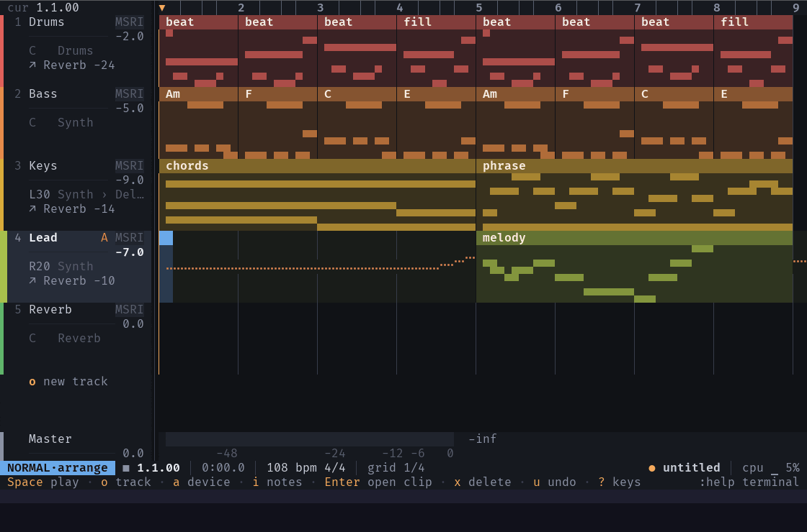

# pattern

A line of text, in the manner of TidalCycles' mini-notation, that becomes the
notes of a MIDI clip and can be changed while the song plays.

```
bd*2 [~ sn] hh(5,8) # vel 1 0.7
```

The text is kept in the clip's `meta`, and the clip's notes are what it
evaluates to over the clip's length. Playback, rendering, the piano roll and
saving see ordinary notes and know nothing of patterns.

```lua
paw.ext.load("extensions/pattern")   -- or put the directory in ~/.config/paw/extensions
```



## Keys and commands

In the arrange view, on the clip under the cursor:

| Keys | Command | What it does |
| --- | --- | --- |
| `<leader>tt` | `pattern.edit` | Edit the clip's pattern on the command line, starting from its text. With no clip under the cursor, a new clip is made there. |
| `<leader>tn` | | A new pattern clip, right after the clip under the cursor (or at the cursor). |
| `<leader>tr`, `<leader>tR` | `pattern.seed` | The next or previous seed: roll the random choices again. A count steps that many. |
| `<leader>tc` | `pattern.cycle` | Ask how many beats a cycle lasts (`bar` for one bar). |
| `<leader>ti` | `pattern.info` | Show the text, the seed and the cycle length. |
| `<leader>td` | `pattern.detach` | Stop the clip following its pattern; its notes stay. |

| Command | |
| --- | --- |
| `:pattern.set <text>` | Give the clip under the cursor this pattern, or make a new clip at the cursor with it. The rest of the line is the text, spaces and all: `:pattern.set bd*2 [~ sn]`. A new clip is `pattern_cycles` cycles long (4), or as many as a count says. |
| `:pattern.edit` | As `<leader>tt`. |
| `:pattern.seed [n]` | Set the seed; with no number the next one, `by=-1` the previous. |
| `:pattern.cycle <beats>` | Beats per cycle, or `bar` (the default: a cycle is one bar, whatever the time signature). |
| `:pattern.info`, `:pattern.detach` | As the keys. |

When the text has a mistake nothing changes, and the message says where:
`pattern: col 4: missing ] for the bracket at col 4`. In the prompt, the
prompt opens again with the text as typed and the error in front of it.

Options: `paw.opt.pattern_names` (true) names a clip after its text, as
`≈ bd*2 [~ sn]`, so the text shows on the clip in the arrange view and `/` can
find it; a clip you have renamed keeps your name. `paw.opt.pattern_cycles` (4)
is the length of a clip made by `pattern.set`, in cycles.

## How a clip follows its text

- Changing the text, the clip's length (longer clips play more cycles), the
  seed, the cycle length or the time signature evaluates it again.
- Moving the clip, muting it, and splitting it leave it following: the left
  part of a split keeps the pattern, cut at the split.
- **Editing the notes by any other means detaches the clip**: piano roll,
  insert mode, transposing, snapping, joining, a script calling `set_notes`.
  The edit is kept, a warning says so, and the text is kept in
  `meta.pattern_detached`, so `<leader>tt` offers it again (submitting it
  replaces the hand edits). Undo takes back the edit and the detaching together.
- Undo and redo bring the text and the notes back together; saving and loading
  keep both.
- While the transport plays, a change reaches the audio engine at the end of
  the key press that made it, so a looping song plays the new notes on the
  next pass without stopping.
- Cycles count from the start of the clip: alternation starts again at every
  pattern clip.
- Copies made by yank and paste, `&` and `clip.duplicate`, and the right part
  of a split, have the notes but not the pattern (the runtime's clip snapshots
  do not carry clip `meta`).

## The language

A pattern describes one cycle, which is one bar unless the clip says
otherwise. Steps separated by spaces share the cycle equally. Each example
below gives the events of the first cycle as *start–end* in cycles.

### Steps

| Syntax | Example | Events |
| --- | --- | --- |
| sequence | `bd sn hh hh` | bd 0–¼, sn ¼–½, hh ½–¾, hh ¾–1 |
| `~` rest | `bd ~ sn ~` | bd 0–¼, sn ½–¾ |
| `[ ]` subdivision | `[bd bd] sn` | bd 0–¼, bd ¼–½, sn ½–1 |
| `.` grouping | `a b . c d e` | the same as `[a b] [c d e]` |
| `*n` faster | `hh*4` | four hh, a quarter each; `[hh sn]*2` plays the pair twice in its step |
| `/n` slower | `[a b c]/2` | a 0–⅔, b ⅔–1⅓ (begins in cycle 0), c 1⅓–2: spread over two cycles |
| `!n` replicate | `bd!3 sn` | bd bd bd sn, four equal steps |
| `!` alone | `bd ! sn` | repeats the step before: bd bd sn |
| `@n` elongate | `a@3 b` | a 0–¾, b ¾–1 |
| `_` | `a _ _ b` | the same as `a@3 b` |
| `..` range | `0 .. 3` | `0 1 2 3` (whole numbers) |

`*` and `/` take a number (`hh*1.5`) or a pattern of numbers: `hh*<2 3>`
plays two hats in one cycle and three in the next. A step repeats at most
256 times, and a clip takes at most 20000 notes from a pattern: past that
the text is refused with an error, as one that does not parse is.

### Cycles

| Syntax | Example | Events |
| --- | --- | --- |
| `< >` alternation | `<c e g>` | c in cycle 0, e in 1, g in 2, c in 3… |
| | `<c e> g` | c g, then e g |
| | `<a <b c>>` | a b a c |
| | `<a!2 b>`, `<a@3 b>` | a a b; a held for three cycles, then b |
| `{ }` polymeter | `{a b c}%4` | four steps a cycle through three: a b c a, b c a b, … |
| | `{a b c, d e}` | each layer at the first layer's steps (3): a+d b+e c+d, a+e b+d c+e |
| `< , >` | `<a b, c d e>` | each layer one step a cycle: a+c, b+d, a+e, b+c… |

### Together

| Syntax | Example | Events |
| --- | --- | --- |
| `,` stack | `[bd, hh*2]` | bd 0–1 with hh 0–½ and ½–1 |
| | `bd*2, ~ sn` | also at the top level |
| `(k,n)` Euclidean | `bd(3,8)` | three hits spread over eight steps: 0, ⅜, ¾ |
| `(k,n,r)` | `bd(3,8,2)` | the same rotated left two steps: ⅛, ½, ¾ |
| | `bd(-3,8)` | the five steps that `bd(3,8)` leaves out |
| | `[bd sn](2,4)`, `bd(<3 5>,8)` | a group on each hit; hits that alternate |

The rhythms are Bjorklund's, as TidalCycles has them: `(5,8)` is `x.xx.xx.`.

### Chance

| Syntax | Example | |
| --- | --- | --- |
| `\|` choice | `a \| b \| c` | one of them each cycle |
| | `[bd \| sn sn] hh` | a choice between sequences, within a step |
| `?` drop | `hh*8?` | each hat dropped with probability ½ |
| `?p` | `hh*8?0.2` | dropped with probability 0.2 |

The choices come from the clip's **seed** (`pattern.seed`, 0 at first), so
the same text and seed always give the same notes, and saving and loading give
them back. Each `|` and `?` in the text decides independently of the others.
`|` binds tighter than `,`: `[a | b, c]` is `[[a | b], c]`.

### Words

| Kind | Examples | Pitch |
| --- | --- | --- |
| Note name | `c4` `eb3` `f#` `Bb2` `cs` `ef5` | `#` or `s` sharp, `b` or `f` flat; the octave is 4 when left out, and `c4` is 60 |
| MIDI number | `36` `60` | the number itself; whole numbers only |
| Scale degree | `1 3 5 # key a3 # scale minor` | numbers, once `key` or `scale` is given: 1 is the root, 8 the octave above in a seven-note scale, 0 the step below the root |
| Chord | `c'maj` `e3'min7` `60'm` `1'maj` | the root and the chord's notes |
| Drum | `bd sn cp hh oh` | General MIDI, see below |

Chords take TidalCycles' names (`major maj M minor min m aug dim dom7 7 maj7
m7 dim7 six 6 m6 sus2 sus4 7sus4 add9 nine 9 m9 maj9 eleven 11 thirteen 13
five 5 one 1 …`) and after another `'`, modifiers applied in order: a number
gives that many notes, going on up by octaves (`c'maj'5` is c e g c e);
`i`, `ii`, `iii` invert once, twice, three times (`c'maj'ii` is g c e); `o`
opens the chord (the first and third notes go down an octave); `d1`, `d2`
drop the highest, the second highest note an octave.

Drums, as `require("pattern").drums`:

| Word | Note | | Word | Note |
| --- | --- | --- | --- | --- |
| `bd` `kick` | 36 | | `hh` `ch` | 42 closed hi-hat |
| `rim` `rs` | 37 | | `ph` `hp` | 44 pedal hi-hat |
| `sn` `sd` `snare` | 38 | | `oh` | 46 open hi-hat |
| `cp` `clap` | 39 | | `lt` `ft` `mt` `lmt` `ht` `hit` | 41 43 45 47 48 50 toms |
| `sn2` | 40 electric snare | | `cr` `crash` `cr2`, `rd` `ride` `rd2`, `rb` | 49 57, 51 59, 53 |
| `cow` | 56 | | `tb` `tamb`, `sp`, `cy`, `vs`, `sh`, `cl` | 54, 55, 52, 58, 70, 75 |

The built-in `drums` device plays 36, 38, 39, 40, 42, 44 and 46. A word in the
drum table wins over a note name, which is why the cowbell is `cow` and not
`cb` (C flat). Other words are errors.

### Parameters

After the notes, `# name values` sets a parameter for each event. The values
are a pattern of their own, and each event takes the value that is playing
when it starts (Tidal's `#`). A `#` is a parameter only at the start of a
word; `f#` is a note.

```
bd*4 # vel 1 0.6 0.8 0.6        velocities 127 76 102 76
c e g c5 # legato 0.5           notes half as long as their steps
1 3 5 <8 7> # key d3 # scale dorian # vel <0.8 1>
c'maj e'min # oct -1 # add <0 5>
```

| Parameter | Values | Effect |
| --- | --- | --- |
| `vel` | 0–1, or above 1 | Velocity: 0–1 is a share of 127 (rounded), above 1 a MIDI velocity (at most 127). 0 drops the note. Without it, notes have `paw.opt.velocity` (100). |
| `legato` | number | Note length as a share of the event's length (1 by default). Notes are cut at the end of the clip. 0 drops the note. |
| `add` | whole number | Semitones up (or down); for degrees, steps along the scale. |
| `oct` | whole number | Octaves up or down. |
| `key` | note name or number | The root, and numbers become scale degrees. |
| `scale` | name | The scale for degrees: `major minor dorian pentatonic minor_pentatonic blues chromatic ionian aeolian phrygian lydian mixolydian locrian harmonic_minor melodic_minor whole_tone`. A scale without a key is rooted on C4. |
| `ch` | number | Kept in each note's `meta.channel`, for a device or extension that reads it; the built-in devices do not. |

Drums are not moved by `add` and `oct`. A rest in a parameter's pattern
leaves the default; notes that end up outside 0–127 are left out, as are
two of the same pitch starting together.

### Errors

Errors give the column, counting from 1: `col 4: unknown name zz: not a note,
a number or a drum`. `pattern.caret(err)` gives the text with a `^` under the
place.

## The module

```lua
local pattern = require("pattern")

pattern.events("bd [sn sn]", 1)       -- { { start = 0, stop = 0.5, text = "bd", pitches = { 36 }, params = {} }, ... }
pattern.notes("bd sn", 2, { beats = 4, seed = 0 })   -- clip notes for two cycles of four beats
pattern.parse("bd [sn")               -- nil, err: err.pos == 4, tostring(err) == "col 4: ..."
pattern.compile(text, seed)           -- a compiled pattern (or nil, err), for events/notes

pattern.set(clip, "bd*2 sn", { seed = 1, beats = 8 })  -- the clip follows the text; nil, err on an error
pattern.get(clip)                     -- { text, seed, beats, ... } or nil
pattern.detach(clip)                  -- keep the notes, drop the link
pattern.refresh(clip)                 -- re-evaluate (done for you on every change)
pattern.refresh_all()                 -- every pattern clip, e.g. after changing the tables below
pattern.clips()                       -- ids of the clips that follow a pattern

pattern.drums.kick2 = 35              -- tables you can change
pattern.chords.mu = { 0, 2, 4, 7 }
pattern.scales.hijaz = { 0, 1, 4, 5, 7, 8, 10 }
```

`opts.beats` is beats per cycle (`false` for one bar); `opts.length` in
`pattern.notes` gives the length in beats instead of a number of cycles.

The pattern a clip follows is `clip.meta.pattern`: `text`, `seed`, `beats`
(nil for a bar), and `digest` and `name`, which the extension keeps to notice
hand edits and its own names. Writing `clip.meta = { pattern = { text = "bd*4" } }`
from a script works too: the clip picks it up at the end of the turn.

Internally a pattern is a function of time in the manner of Tidal (events have
a whole and a part, and only onsets become notes); `pattern.core` has `pure`,
`stack`, `timecat`, `fast`, `early`, `compress`, `euclid`, `degrade`,
`choose` and `bjorklund` for building patterns from Lua.

## What of Tidal's notation is not here

- Functions and operators outside the mini-notation: `every`, `jux`, `off`,
  `sometimes`, `+` and `|+|` between patterns, `~>` and `<~`, continuous
  patterns such as `sine` and `rand`. Parameters are combined only with `#`.
- Sample indices with `:` (`bd:3`), and sample names in general: words are
  notes, drums or chords.
- Patterned `@`, `!` and `?` amounts, and `?` and `|` giving exactly Tidal's
  random values: the choices are deterministic per seed but are not Tidal's.
- Tidal numbers degrees from 0 and calls middle C `c5`; here degrees count from
  1, as `paw.music.degree` does, and middle C is `c4`.
- Variables (`^name`) and the `-` rest.
- Cycles are counted from the start of each clip, not from the start of the
  song.
