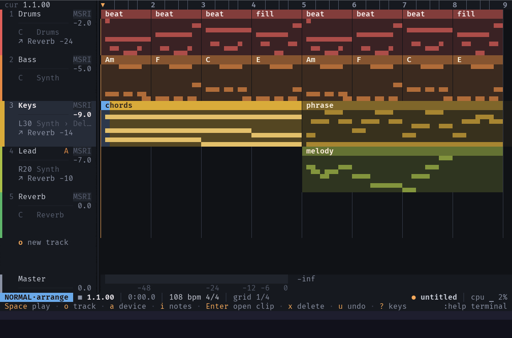

# rpp: a bridge to REAPER

Opens REAPER projects (`.rpp`) in paw, and writes the projects of paw as
`.rpp`. So work can move in both directions. Below is a reader and writer
of the file format, which scripts can use alone.

```lua
paw.ext.load("/path/to/paw/extensions/rpp")   -- or link it into ~/.config/paw/extensions
```



## Try it

1. Type `:ext.load rpp`.
2. Type `:e song.rpp` with the path of a REAPER project. The tracks of the
   REAPER project appear in the arrange view.
3. Read the page that opens over them. It lists what paw could not bring
   across, by kind. If paw brought all of it, there is no page.
4. Type `:w copy.rpp`. The message tells how much paw wrote.
5. Open `copy.rpp` in REAPER. The tracks and the clips are there.

## How to

### How to open a REAPER project

Type `:e song.rpp`. The page that opens lists what paw could not bring
across, grouped by kind.

If the MIDI tracks are silent because their instrument stayed in REAPER,
type `:rpp.import song.rpp instrument=synth`. Each such track gets a
`synth`.

### How to add the tracks of a REAPER project to this project

Type `:rpp.import song.rpp merge=true`. The project keeps its own tempo
map.

### How to write a project for REAPER

Type `:w song.rpp`. The page that opens lists what paw could not write.

### How to edit a `.rpp` file from a script

```lua
local rpp = require("rpp")
local doc = rpp.read("song.rpp")
doc.project:set("TEMPO", 96, 4, 4, 0)
rpp.save(doc, "song.rpp")
```

Lines that you do not change keep their bytes.

## Reference

### Commands

| Command | Effect |
| --- | --- |
| `:rpp.import song.rpp` | replaces the project with the REAPER project. `merge=true` adds its tracks to the current project. `instrument=synth` gives a device of that kind to MIDI tracks whose instrument stayed behind, so you can hear them |
| `:rpp.export song.rpp` | writes the project as a REAPER project |
| `:edit song.rpp`, `:e song.rpp` | the same as `rpp.import`. Other files open as before |
| `:write song.rpp`, `:w song.rpp` | the same as `rpp.export`. Other files save as before |

The extension has no keys of its own.

After an import or an export, a page lists what paw could not bring
across, grouped by kind (plugins, takes, envelopes, and other). The
message line tells how much came across. paw lists every item that it
drops.

```lua
local rpp = require("rpp")
local result = rpp.import("song.rpp", { instrument = "synth" })
print(result.report:text())            -- or result.report:data() as tables
rpp.export("out.rpp").report:empty()   -- true when paw wrote all of it
```

### The format

`rpp.parse(text)` gives a tree. `rpp.write(tree)` gives the text back.

- A tree with no changes writes the same bytes that it came from:
  indentation, quotes, number format, CRLF or LF.
- A changed or added line is written as REAPER writes it.
- The parser never fails. It keeps what does not fit (a `>` alone, a block
  that does not close) as it is.

```lua
local doc = rpp.read("song.rpp")
local project = doc.project                         -- the <REAPER_PROJECT block
project:getn("TEMPO")                               -- 120: the first argument as a number
project:set("TEMPO", 96, 4, 4, 0)                   -- replaces a line (or adds it)
for _, track in ipairs(project:blocks("TRACK")) do
  print(track:get("NAME"), track:child("VOLPAN"):argn(1))
  track:add(rpp.line("MUTESOLO", 1, 0, 0))
end
local fx = project:child("TRACK"):child("FXCHAIN"):child("VST")
fx:data_groups()                                    -- the base64 parts of the state of a plugin
rpp.save(doc, "song.rpp")
```

A node is `{ tokens = { name, args... }, children = {...} }`. Blocks have
children. Lines do not.

| Method | Effect |
| --- | --- |
| `name`, `arg(i)`, `argn(i)`, `set_args` | the tokens |
| `child(name)`, `all(name)`, `blocks(name)` | the children |
| `get(key, i)`, `getn(key, i)`, `set(key, ...)` | a line by its key |
| `add(node, index)`, `add_before(name, node)`, `remove`, `remove_all(name)` | add and remove nodes |
| `data()`, `data_groups()`, `set_data(groups, width)` | the base64 data of a block |
| `quoted(i...)` | always quotes these arguments, as REAPER does for paths |
| `walk(fn)` | calls `fn` on each node |

`rpp.format.quote` and `rpp.format.number` are the quotes and the number
format of REAPER. A token has no quotes, unless it is empty, holds a blank
or starts with a quote. Then it takes the first of `"`, `'` and `` ` `` that
it does not contain. The format has no escapes.

### What comes across

A REAPER project gives times in seconds. paw changes them to beats with the
tempo map of the project, and back.

| | REAPER → paw | paw → REAPER |
| --- | --- | --- |
| Tempo, time signature | The full tempo map: `TEMPO` and the `TEMPOENVEX` points. Square points become steps. Linear points become ramps (linear in time, as REAPER plays them), with their time signatures (packed as numerator + denominator × 65536). Other point shapes become ramps and are reported. When merged into an open project, the project keeps its own map | `TEMPO`, and `TEMPOENVEX` when the tempo or the signature changes along the song |
| Loop | Loop points (`SELECTION`) and the repeat switch (`LOOP`) | The same |
| Markers and regions | The markers and regions of paw (`paw.markers`), with their colors | The same. Song sections (`project.meta.sections`) become regions, each to the start of the next |
| Tracks | Name, color (`PEAKCOL`), volume, pan, mute, solo, record arm, audio input and monitoring | The same |
| Folders | The children of a folder go into the folder track | A track that goes into the track above it (or into its folder) becomes a child of the folder. paw writes other routes into a track as a send from a track with its parent send off, and reports them |
| Sends | Receives (`AUXRECV`) become sends from the source track, at their level. Pre-fader receives become pre-fader sends | Sends become receives, post-fader or pre-fader |
| Master | Volume, pan, mute, FX chain, volume and pan envelopes | The same |
| Audio items | A clip with the file (relative to the project folder, as REAPER finds it, also in the recording folder), position, length, start in the source (`SOFFS`, also the start of a section), item volume times take volume as the clip gain, fade lengths, play rate and pitch shift, mute. A looped item becomes a looped clip. At a play rate other than 1, it becomes one clip for each pass | Items with a `WAVE`, `FLAC`, `MP3` or `VORBIS` source, with the same fields. A looped clip becomes a looped item that plays a section of the file. Paths under the folder of the project are relative to it |
| MIDI items | Notes from inline events and from `.mid` files, with velocity and channel (in `meta.channel` of the note), through the ticks per quarter note of the source. Controllers, pitch bend, channel and key pressure, and program changes (with the bank before them) become the controller moves of the clip. A source that ignores the project tempo runs at its own. A looped item becomes a looped clip. Notes held over the item start begin at it, as REAPER plays them. Muted items stay muted | Inline events at 960 ticks per quarter note, channels from `meta.channel`, and the controller moves. A looped clip becomes a looped item |
| Automation | Volume and pan envelopes of tracks and the master, and the parameter envelopes (`PARMENV`) of plugins that came across, as lanes, on or off as in REAPER. Square points hold. Slow start and end points become smooth | The same |
| CLAP plugins | When installed here: the same plugin with the state that REAPER saved, which is the own state of the plugin | With their state |
| VST3 plugins | When installed here (found by the class id in the line of REAPER, else by name and vendor): the same plugin with its state, from the chunk of REAPER (paw checks the sizes first) | Only plugins that came from a REAPER project: paw keeps the header of REAPER for them, and puts the current state into it |
| LV2 plugins | When installed here: the same plugin with its control ports (`P` lines. The symbols of the ports are the parameter keys of paw) | With their control ports |
| Bypass | For each plugin, and a bypassed FX chain | For each plugin |
| Other plugins | VST2, JSFX, AU, DX, containers, and plugins that are not installed: a placeholder in `meta.rpp_placeholders` of the track (`name`, `format`, `position`, `reason`, and the text of REAPER for it), reported | Placeholders return into the chain at their places, as paw read them |

REAPER counts the parameters of a plugin from 0, in the order of the
plugin. paw lists them in the same order. For a CLAP or VST3 plugin, REAPER
writes the id of the plugin for the parameter after the place, as a signed
32-bit number: `<PARMENV 5:-1611133501`. paw writes and reads the same
form. It finds the parameter by the id first. An envelope then stays on
its parameter in a version of the plugin with a different order.

A parameter envelope gives values from its minimum to its maximum, and
paw scales them to the range of the parameter. See
[Device parameters](../../docs/reference/device-parameters.md).

### What does not come across

paw lists these after each import or export.

- **REAPER → paw:**
  - tempo envelope points with shapes other than square and linear
  - inactive takes, fade shapes (paw fades on a quarter sine), the play
    rate and pitch shift of MIDI items
  - take pan, polarity and channel modes, take envelopes and stretch
    markers
  - sysex and text events, muted MIDI notes and muted controller events,
    controllers on MIDI channels other than 1 (they play on channel 1)
  - envelopes other than volume, pan and plugin parameters (width, mute,
    send envelopes), and envelopes of plugins that did not come across
  - the curve shapes 3, 4 and 5 of REAPER (fast start, fast end and a
    curve with handles: they become straight lines or smooth)
  - pre-FX sends (they become pre-fader), send pan, send channel mapping,
    muted sends and MIDI-only sends
  - tracks whose master or parent send is off (in paw they play through
    their output), hardware outputs, frozen tracks
  - empty items, video, subprojects, other sources, media files that paw cannot find
  - LV2 state other than control ports, offline plugins, the volume of
    MIDI items
- **paw → REAPER:**
  - built-in devices (`synth`, `drums`, `gain`, `delay`) and other devices
    that are not plugins, and their automation
  - VST3 plugins added in paw (paw does not know the id of REAPER for them)
  - LV2 state other than control ports
  - the tension of smooth curves, stretch modes and warp markers, the loop
    of a stretched audio clip
  - registered and assignable controllers and per-note controllers (MIDI
    1.0 has no event for them)
  - note attributes (MIDI 2.0 articulations: a REAPER project keeps MIDI
    1.0)
  - note times finer than 1/960 beat are rounded
  - clips in the slots of the clip launcher
- paw does not read the settings of a REAPER project that it has no place
  for (render settings, grid, view, metronome, project notes). It writes
  the defaults of REAPER for them.

### Tests

The suite runs `tests.lua`, with fixtures written by hand in `fixtures/`.
The tests cover:

- parse and rewrite
- an import, checked track by track and clip by clip
- MIDI times at three tempos, envelopes, the report
- an export, then an import, of a project made with the API
- plugins in all three formats
- a render of an imported project with audio and MIDI
- REAPER itself opens an exported project
- REAPER itself makes and saves a project, and paw imports it

The parser was checked on 24 project files saved by REAPER, up to 2.9 MB.
It gave the same bytes, and the same tokens after it wrote every line
again.

The first REAPER test opens an exported project in REAPER. Then it compares
what REAPER read with the project of paw. It compares the tracks, folders,
colors and sends. It compares the items with their fades, play rates and
loops. It also compares the notes, the controller events, the envelope
shapes, the markers and regions. The REAPER tests run when `PAW_REAPER`
names the `reaper` program. Otherwise the suite skips them:

```sh
PAW_REAPER=/path/to/reaper nix develop -c tests/tools/suite.sh only "REAPER"
```

`tools/reaper-open.sh song.rpp dump.txt` does the same for any project.
REAPER runs in a sandbox (`bwrap`) on a private X display, with no audio
device and its own new configuration. It does not touch the configuration
of a REAPER that you have. The startup script `tools/reaper-dump.lua`
writes what REAPER read, then REAPER stops.

The second REAPER test gives a third argument, `tools/reaper-build.lua`.
REAPER then runs this script in a new project, which makes a song with the
API of REAPER. REAPER saves the song as `song.rpp`. paw imports it and
compares it with what REAPER wrote about it.

Some rules come from projects saved by REAPER 7.84, and from REAPER 7.84
itself, not from documentation:

- Volume envelope points are amplitudes in the file, also with
  `VOLTYPE 1`.
- Pan envelope points go from +1 (left) to -1 (right).
- A color in the file is red + green × 256 + blue × 65536, plus 0x1000000
  when the color is in use.
