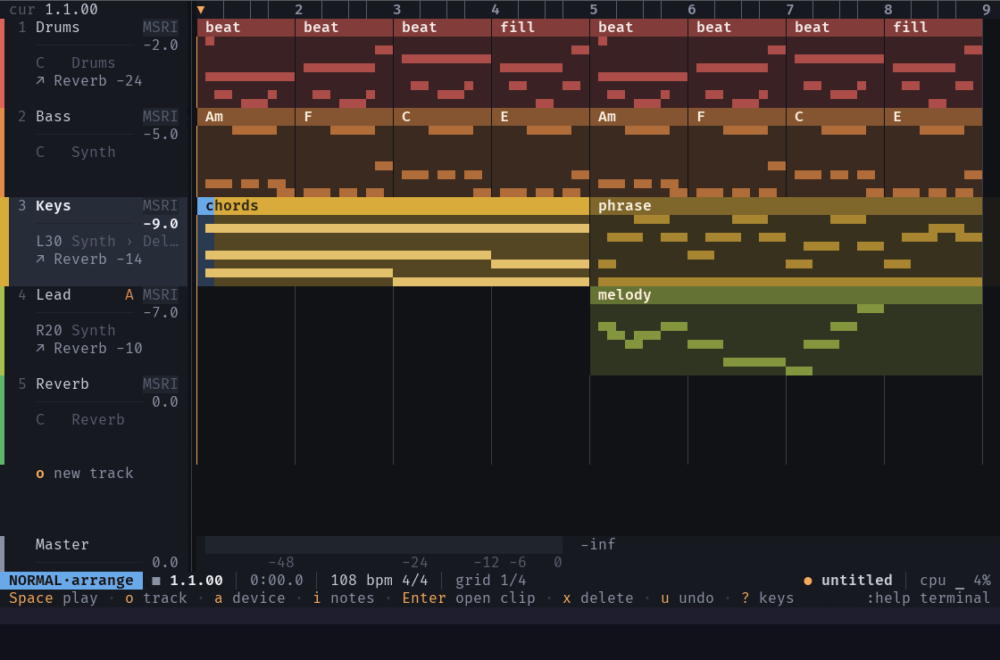

# templates

A track, a group of tracks, or a chain of devices saved under a name, to make
again in any project: a vocal track with its chain and levels, a string
section with every instrument, a mastering chain.

```lua
daw.ext.load("/path/to/daw/extensions/templates")   -- or link it into ~/.config/daw/extensions

local templates = require("templates")
templates.save_track(track, "Lead vocal")        -- devices with their settings, levels, automation
templates.save_fx(track, "Vocal chain")          -- the devices alone
templates.save_group(group, "String section")    -- a group and every track in it
templates.load("Lead vocal")                     -- made again below the cursor track
```



| Keys | Command | |
| --- | --- | --- |
| `,Ts` | `template.save [name]` | Save the cursor track; on a group, the group with every track in it |
| `,Tf` | `template.fx [name]` | Save the track's devices as a chain |
| `,Tl` | `template.load [name]` | Make a template again: a track or group below the cursor track, a chain at the end of the cursor track's devices. A part of the name is enough; with none, choose from a list |
| | `template.delete [name]`, `templates` | Delete one; list them |

In the graphical frontend: `Track` → "From a template…", and in a track's
menu "Save as a template…", "Save its devices as a chain…" and "Add devices
from a template…".

## What a template holds

- **A track**: its name, level, pan, colour, input, devices with their
  parameters and plugin state, automation lanes, and what extensions keep
  with it (a drum map). Its clips only if asked for
  (`templates.save_track(track, name, { clips = true })`).
- **A group**: the group's own track and every track in it, groups inside it
  included, each as above. Made again, the members play into the new group.
- **A chain**: the devices of a track, in order, with their parameters and
  plugin state.

Left out on purpose: the track a template's track played into and the
tracks it was sent to. Those belong to the project it came from.

Templates are JSON files in `~/.local/share/daw/templates/<kind>/<name>.json`
(`daw.opt.templates_dir` puts them elsewhere), in the shape
`Track:snapshot()` gives.
